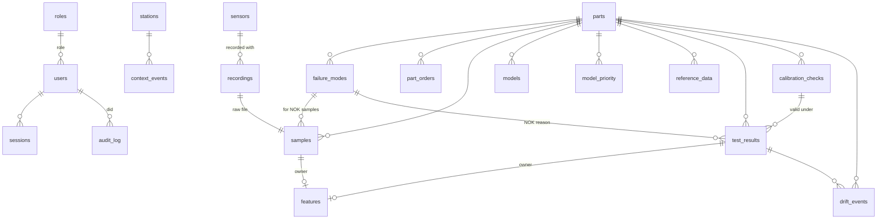

# Database: schema and data dictionary

SQLite in WAL mode (why: `../decisions/2026-11-22-database-sqlite-wal.md`). File: `<data dir>/eol.sqlite3`. Schema version 1, defined in `app/eol_app/migrations/0001_initial.sql`; that file is the authority if this page and it ever differ.

Conventions: times are UTC text, `2026-11-22T10:02:31Z`. `*_json` columns hold JSON text. "Deleted" rows are kept with a `deleted_utc` (soft delete), because deletions are audited and the history must stay readable.

## How the tables connect



## Tables

| Table | One row is | Key columns and rules |
|---|---|---|
| `roles` | a role | `programming`, `setup`, `testing` (fixed) |
| `users` | a login | `username` unique, case-insensitive, up to 32; `password_hash` scrypt; `must_change_password`; `failed_logins`, `locked_until_utc` (lockout); `is_master`: exactly one master; `active` |
| `sessions` | a logged-in browser | `token_sha256` (the token itself is only in the browser's cookie); `csrf_token` checked on every form; `ended_utc` at logout or idle timeout |
| `audit_log` | something someone changed | `at_utc`, `user_id`, `action` (for example `sample_saved`, `setting_changed`, `account_locked`), `object_type`, `object_id`, `detail` (JSON) |
| `settings` | a programming variable | `key`, `value`, `kind`, `min_value`, `max_value`, `step`, `default_value`, `unit`, `description`, who changed it last. Changes are audited with old and new value |
| `stations` | a test station | `name`, `machine_code` (for the licence binding later) |
| `shifts` | a shift | `name`, `start_local`, `end_local` (HH:MM) |
| `context_events` | a change of operator, part or shift | `kind`, `value`, `at_utc`. Results are matched to their context by time, instead of repeating it on every row |
| `sensors` | a microphone or accelerometer | `identity` (unique; written into every recording), `model`; ADXL383: `adxl_range_g`, `adxl_odr_hz`, `adxl_axes` |
| `parts` | a part number | `part_number` unique, up to 20; `description` up to 60; `tach_connected` and `tach_ppr` (PPR required if the tach is connected); `capture_s`; `adxl_enabled`; `archived_utc` |
| `part_orders` | an order of interest | `kind` (`gear_teeth`, `slot_pole`, `bearing`, `other`), `order_value` > 0 |
| `failure_modes` | a named NOK type of a part | `name` up to 30, unique per part among undeleted ones; soft delete |
| `recordings` | a permanent raw recording | `id` = the file name (`rec-...`), `path`, `sha256`, `bytes`, `seconds`, `clock_hz`, `sensor_id`, `firmware`, `filter_name`, `filter_sha256`, `purpose` (`golden`, `failure_mode`, `bench` only) |
| `samples` | a calibrated sample | `kind` `golden` or `failure_mode` (then `failure_mode_id` is required, otherwise it must be empty); `sample_set` `training` or `validation`; `unit_serial` (the physical part, so cross-validation can keep one unit's samples together); `recording_id` unique; soft delete |
| `aborted_captures` | a capture thrown away in Setup (Retest) | `target`, `valid`, `reasons`, who and when |
| `features` | the analysed values of one sample or one test result | `owner_type` + `owner_id` unique; `catalogue_version`; `filter_name`, `filter_sha256`; `gain` (golden-relative scaling); `values_json`. Pruned features are removed from it |
| `reference_data` | something derived from the golden part | `kind`, `value_json` (for example the reference gain) |
| `models` | a trained model of one method for one part | `method`, `version` (unique per part and method); `state` `trained`, `approved`, `retired`, `invalidated`; `feature_names_json`, `pruned_json`, `params_json`, `metrics_json` (cross-validated escape and false-reject rates), `artifact_path` + `artifact_sha256`; who trained and approved |
| `model_priority` | a place in a part's method order | `position`, `method`, `enabled` |
| `calibration_checks` | the check at the start of a part | golden and reject result ids, `passed`, `gain` |
| `test_results` | one test of one part | `verdict` `OK`, `NOK`, `UNDEFINED`, `INVALID`; `failure_mode_id` only with NOK; `drift` (yellow controlled drift); `invalid_reasons`; `decision_json` (distances, probabilities, thresholds, reasons, model versions); `gain`; `retest_of`; `unit_serial`; `calibration_check_id`; `purpose` (production or a calibration part) |
| `drift_events` | a feature moving towards a limit | `feature`, `rule`, `value`, `limit_value`, acknowledgement |
| `io_events` | a Start, output change, watchdog trip, emergency exit | `kind`, `detail_json` |
| `edge_outbox` | a message waiting for a future edge server | `topic`, `payload_json`, `sent_utc`, `attempts`, `last_error` |

What is enforced by the database itself (so a bug in the application cannot store it): field lengths, allowed values, foreign keys, one master login, a PPR when the tach is connected, a failure mode only on NOK samples and results, unique part numbers and recording ids.

## Backup

The database is one file. Copy it with SQLite's online backup while the application runs:

```
python3 -c "import sqlite3; sqlite3.connect('$HOME/eol-data/eol.sqlite3').backup(sqlite3.connect('/media/usb/eol-backup.sqlite3'))"
```

(Change `/media/usb` to wherever the USB stick is mounted.)

The recordings folder beside it holds the raw files; back it up with it. A backup command in the application comes with step 11.
