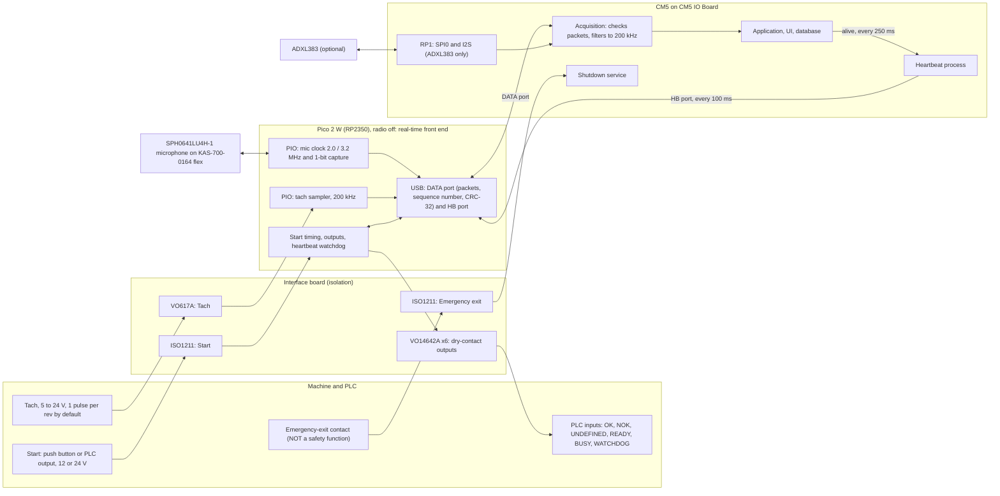
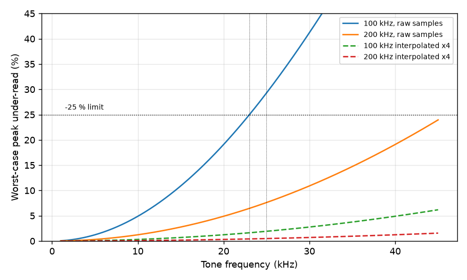
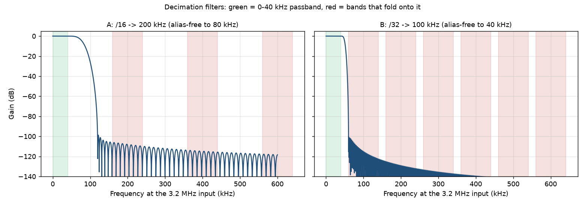
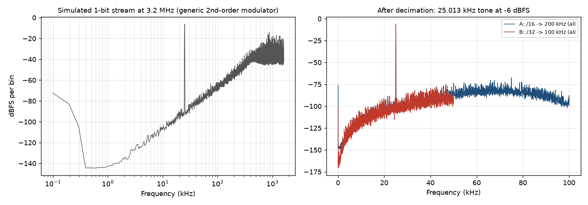

# Phase 0: Hardware design review

EOL vibro-acoustic test stand, Zynith IT Solutions Pvt Ltd.
Status: **Revision B. Approved on 2026-11-21 with the decisions recorded in section 12. Build-plan step 2 is done: bench items 16 to 19 passed on the Pico 2 W and CM5. Step 3: microphone capture and decimation filter work on the bench. Steps 4 and 5 are done: storage, database and Setup work on the CM5 with the real microphone.**
Date: 2026-11-21. Branch: `rev-2`.

Nothing in this document has been run on hardware. Section 13 lists what was run on a laptop and what is untested on the target.

**What changed in revision B** (after approval):

| Change | Where |
|---|---|
| Board is a Pico 2 W, radio off; pin map and power-mode note rechecked | 6.1 |
| Microphone board identified; pinout given by the owner on 2026-11-22, to be confirmed on the board before power | 6.5 |
| End of capture (ultrasonic to sleep by stopping the clock): datasheet evidence | 3.3 |
| SELECT unknown: firmware and footprint work either way, with a detection test | 3.4 |
| Filter timing kept separately for CM4 and CM5; decimation ratio is a setting | 4.7 |
| Microphone overload detection and placement limits | 4.8 |
| Two USB serial ports; heartbeat from its own process; timeouts stated | 6.2, 7.2 |
| Tach input for 5 to 24 V; dry-contact outputs for any PLC | 7.1, 7.4, 7.5 |
| ADXL383 section written from its datasheet | 8 |
| Bench checklist replanned for no instruments; accepted risks listed | 10 |

## 0. Summary

**What is being built** (approved)

- The Pico 2 W, with its radio switched off, is the real-time front end. It makes the microphone clock, captures the raw 1-bit microphone stream, samples the tach, handles Start, and drives the six result/status outputs. It sends everything to the CM5 over its USB cable as numbered, checksummed packets. A second serial port on the same cable carries only the heartbeat.
- The CM5 turns the 1-bit stream into 200 kHz samples in software (divide by 16; divide by 32 is a setting), runs the application, and owns the emergency-exit input and the optional ADXL383.
- System clock 128 MHz, so the wake-up clock (2.000 MHz) and the ultrasonic clock (3.200 MHz; 4.000 MHz selectable) are exact whole-number divisions.

**Findings to keep in mind**

1. **The microphone is not flat at 25 kHz.** Its typical response peaks at about +14.5 dB near 25 kHz [MIC s7, read from the graph, **[NOT VERIFIED]**]. Approved handling: no correction, golden-relative scaling, microphone identity stored. See 4.5.
2. **100 kHz raw samples miss the -25 % limit at 25 kHz** (-29.3 %). 200 kHz gives -7.6 %. See 4.1.
3. **The ADXL383 datasheet has now been read, and three of the notes do not hold as written.** The 68 µs group delay belongs to a 64 kHz low-latency mode, not to the 16 kHz equalised setting (which is 246 to 265 µs). The overrange flag trips near 110 g, not at ±15 g. And with the ADXL383 making the clocks, 32 kHz comes only with 16-bit words. See section 8.
4. **With no instruments, some Phase 0 limits cannot be proven at all**: clock edge time, jitter, absolute sound level, the microphone's real response. They are listed as accepted risks in 10.4, with the relative test that stands in for each.
5. **The microphone board's own pinout sheet could not be opened.** The microphone on it is the one Phase 0 assumed, so the microphone figures stand. On 2026-11-22 you gave the pinout (Ground, Power, Data, Clock, Select, Ground) and a Knowles guide whose picture agrees with it. It is confirmed on your own board by bench item 46 before power is applied. See 6.5.

**Still needed from you** is in section 12.3. Nothing there blocks step 2.

## 1. Sources

Every figure below cites one of these. "s" is the sheet number, "p" the printed page number.

| Key | Document | Version read | Opened? |
|---|---|---|---|
| MIC | Knowles SPH0641LU4H-1 datasheet (the Digi-Key link you gave) | Rev B, 04/06/2015, 15 sheets | Yes, all sheets |
| RP | Raspberry Pi RP2350 datasheet | Release 9, build 19/11/2026 | Yes: 8.6, 9.6, 9.7, 11.5.5, 11.5.6.3, 14.9, Appendix D.5.1 |
| P2 | Raspberry Pi Pico 2 datasheet | Release 5, build 03/07/2026 | Yes, all |
| CM5 | Raspberry Pi Compute Module 5 datasheet | history entry 19 November 2026 | Yes, all |
| IO | CM5 IO Board datasheet RP-008182-DS-3 (your link) | Release 3, build 11/09/2026 | Yes, all, including Figure 5 |
| RP1 | Raspberry Pi RP1 Peripherals | build 2023-11-07 | Yes: 2.5, 3.1, 3.7 |
| ISO | TI ISO1211/ISO1212 datasheet SLLSEY7G | Rev G, February 2025 | Yes: 4, 5, 8.2 |
| VO | Vishay VO617A datasheet, doc 83430 | Rev 2.8, 22-Jan-2025 | Yes: pages 1 to 4 |
| VOR | Vishay VO14642AT / VO14642AABTR solid-state relay datasheet, doc 81646 | Rev 1.9, 28-Jul-2026 | Yes: pages 1 to 3 |
| P2W | Raspberry Pi Pico 2 W datasheet RP-008304-DS-4 | Release 3, build 19/11/2026 | Yes: 1, 2.1, 3.1, 3.3, 3.4 and Figure 2 |
| KAS | Digi-Key product page for Syntiant KAS-700-0164 (your link) | fetched 2026-11-21 | Partly: a fetch tool returned a summary of the page, not its text |
| KSG | Knowles "MEMS Microphones for Full Range Audio and Ultrasonic Applications (Consumer) Selection Guide" (the PDF you supplied, `mic_selection_guide_v121222.pdf`) | footer KNO_MEMS MIC R5, (c) 2022, 4 pages | Yes, all 4 pages. It does not mention KAS-700-0164 or SPH0641LU4H-1. Used for the flex picture and the connector text on page 4 |
| SUN | sunrom.com product pages 7400 ("8P PCB with 0.5mm FFC Connector Soldered") and 5673 ("8P 0.5mm Flip Lock FFC/FPC Connector") | fetched 2026-11-22 | Partly: a fetch tool reported the pages' text. Page 7400 says only "Other side has empty 1mm FPC connector layout". It gives no contact side, no pad numbering and no drawing |
| KFX | Knowles KAS-700-0154 product brief (a sibling flex board, analog microphone), from Digi-Key's document server | (c) 2020 | Yes, 1 page. Used only for what it says about the flex connector in general |
| KRN | raspberrypi/linux, branch `rpi-6.18.y` (`sound/soc/dwc/dwc-i2s.c`, `arch/arm64/boot/dts/broadcom/rp1.dtsi`, overlays `README`) | fetched 2026-11-21 | Yes, the parts cited |
| OS | downloads.raspberrypi.com `os_list_imagingutility_v4.json` | fetched 2026-11-21 | Yes |
| ADXL | Analog Devices ADXL383 datasheet (the PDF you supplied) | Rev. 0, 106 pages, PDF dated 14 May 2026 | Yes. Text read in full except the activity/tap register pages 85 to 89 (skimmed). Performance plots (Figures 13 to 57) not read |

Not opened: the Knowles microphone selection guide that Digi-Key links as the KAS-700-0164 "datasheet", and any Knowles product brief for KAS-700-0164. knowles.com refuses automated downloads and I did not work around that.

`P2` citations outside section 6.1 are about the RP2350 chip and things the Pico 2 and Pico 2 W share. I rechecked against `P2W` only the items in 6.1.

The repository had only a one-line README, so it could not confirm "RP2350". The Pico 2 datasheet does: "RP2350A microcontroller with 4 MB flash" [P2 1, p3].

Conventions: **[NOT VERIFIED]** marks anything not proven from a document I opened. "Read from graph" means a value taken by eye from a datasheet plot, good to about 1 dB.

## 2. Block diagram



Why the Pico does the time-critical work: the same firmware and the same USB link then serve a CM5 and a CM4 unchanged. Only the optional ADXL383 path depends on the CM5's RP1 chip.

## 3. Microphone start protocol (item 1)

### 3.1 What the datasheet says

| Fact | Value | Source |
|---|---|---|
| Sleep mode clock | 0 to 250 kHz | MIC s2 |
| Low-power mode clock | 351 to 815 kHz | MIC s2 |
| Standard mode clock | 1.024 to 2.475 MHz | MIC s2 |
| Ultrasonic mode clock | 3.072 to 4.8 MHz | MIC s2 |
| Forbidden transitions | "Do not power up into ultrasonic mode. Do not wake-up from sleep mode into ultrasonic mode." | MIC s5 |
| Wake-up time (sleep to active, clock at or above 351 kHz) | 15 ms max | MIC s2, note 6 on s4 |
| Power-up time (VDD applied) | 50 ms max | MIC s3 |
| Mode-change time | 10 ms max | MIC s3 |
| Fall-asleep time (clock at or below 250 kHz) | 10 ms max | MIC s2 |
| Sleep current | 80 µA typical | MIC s2 |
| Ultrasonic supply current at 3.072 MHz, 1.8 V | 845 µA typical, 1000 µA max | MIC s3 |
| Clock duty cycle above 2.4 MHz | 48 to 52 % | MIC s4 |
| Clock duty cycle up to 2.4 MHz | 40 to 60 % | MIC s4 |
| Clock rise/fall time | 3 ns max | MIC s4 |
| Data valid after its clock edge (tDD) | 18 min, 28 typ, 40 max ns | MIC s4 |
| Data released after the opposite edge (tDZ) | 3 min, 16 max ns | MIC s4 |
| SELECT = GND | data asserted on the falling edge, latch on the rising edge | MIC s8 |
| SELECT pin | internally pulled low, "should not be left floating" | MIC s9 |
| Supply | 1.62 to 3.6 V | MIC s2 |
| Logic input high | 0.7 x VDD min, 3.6 V max | MIC s4 |

Your recollection checks out: a 2 MHz wake-up clock is inside standard mode, and 3.072 to 4.8 MHz is the ultrasonic range. The datasheet needs less waiting than 50 to 100 ms from sleep (15 ms), but 100 ms costs nothing here, so I keep it.

### 3.2 Sequence on every Test

VDD stays on all the time, so the 50 ms power-up time is spent once at boot. The clock is held low between tests, which is sleep mode (80 µA).

| Time | Pico action | Mic state | Datasheet limit |
|---|---|---|---|
| t = 0 | Start seen. Clock starts at 2.000 MHz | sleep to standard | wake-up 15 ms max |
| t = 100 ms | Clock changes to 3.200 MHz | standard to ultrasonic | mode change 10 ms max |
| 100 ms to 1 s | Pre-roll. Data is streamed but not recorded. The CM5 checks it (share of 1 bits near 50 %, no stuck line) | ultrasonic, settled | 890 ms of margin |
| t = 1.000 s | Start still held: capture begins. READY off, BUSY on | ultrasonic | |
| t = 1 s + T | Capture ends (T = 5 to 10 s). Clock stops, held low | to sleep | fall-asleep 10 ms max |
| Start released before 1 s | Cancel. Clock stops. Event logged | to sleep | |

The 1 s hold you specified is also the mic's settling time, so wake-up adds no delay.

The clock change at 100 ms is meant to be glitch-free: the PIO divider is changed while the state machine keeps running. With whole-number dividers every high and low phase is a whole number of system clock cycles [RP 11.5.5, p821], so no short pulse should appear; one period at the change may have unequal halves. **[NOT VERIFIED]**: the section I read does not say exactly when a new divider value takes effect, and the mic datasheet does not say how it treats one uneven period. Bench item 9 checks both.

Open point: the clock rise/fall limit of 3 ns [MIC s4] is tight. The Pico 2 datasheet says RP2350 edge rates "are very fast" [P2 3.1, p8] but gives no number. A long flex cable will slow the edge. Without a scope this cannot be measured: it is an accepted risk (10.4).

### 3.3 End of capture: ultrasonic straight to sleep (check a)

The sequence in 3.2 stops the clock at the end of a capture, which takes the microphone from ultrasonic mode to sleep. You asked for the datasheet text that permits this.

What the datasheet shows:

- **The state diagram [MIC s5] has an arrow from Ultrasonic Mode to Sleep Mode with one arrowhead, at the Sleep end.** The links between Ultrasonic and Standard, and between Ultrasonic and Low-Power, have arrowheads at both ends. So the diagram draws ultrasonic to sleep as allowed and sleep to ultrasonic as not allowed. Read from the figure by eye.
- The two notes under the diagram say the same thing in words, and only that: "Do not power up into ultrasonic mode. Do not wake-up from sleep mode into ultrasonic mode." [MIC s5].
- Sleep is defined by the clock alone: "Sleep Mode ... fCLOCK ≤ 250 kHz" [MIC s5]. The fall-asleep time is 10 ms max [MIC s2], defined as "Time from fCLOCK < 250 kHz to ISLEEP specification is met when transitioning from Active Mode to Sleep Mode" [MIC s4, note 5]. "Active Mode" is not limited to one of the active modes.
- The diagram also has a one-way arrow from Ultrasonic Mode to Powered Down Mode.

Conclusion: stopping the clock from ultrasonic mode is a drawn transition. **The end-of-capture sequence in 3.2 is unchanged.**

What is not proven: no sentence in the datasheet states it; the evidence is arrow directions in a figure. **[NOT VERIFIED]** on hardware. If the bench shows trouble on the capture that follows (10.3 item 41 would show a changed noise floor), the fallback is the one you suggested: run 10 ms at 2.000 MHz before stopping. The firmware will keep the end-of-capture sequence in one function so that is a one-line change.

### 3.4 SELECT is unknown: the design works either way

SELECT decides which half of the clock the microphone drives the data line in [MIC s8]:

| SELECT | Microphone drives DATA after | Host reads just before |
|---|---|---|
| GND | the falling edge | the rising edge |
| VDD | the rising edge | the falling edge |

In the other half the microphone releases the line (the timing diagram on MIC s8 shows "High Z").

**Firmware, as built in step 3.** One small PIO program reads the line at both clock edges all the time: "L" at the rising edge (the line as it was at the end of the low half) and "H" at the falling edge (the end of the high half). The firmware core then forwards the half that carries the data. This replaces the three programs planned in revision B: one program, no switching, and the probe needs no special mode. The margins in 5.3 are the same for both polarities, because the two cases are mirror images.

**Detection test, no instruments.** Over about 100 000 periods the core counts how neighbouring reads differ:

```
 SELECT = GND:  mic drives in the low half, lets go in the high half
                L[n] = data bit,   H[n] = the same bit after the mic let go
 SELECT = VDD:  mic drives in the high half, lets go in the next low half
                H[n] = data bit,   L[n+1] = the same bit after the mic let go
```

Two reads of the same bit can differ in one direction only: the direction the released line drifts in. Two reads either side of a bit boundary differ in both directions, about equally often. So the pairing in which one direction (almost) never occurs is the same-bit pairing, and that names SELECT.

| L then H: smaller of the two directions | H then next L: smaller of the two directions | Verdict |
|---|---|---|
| about zero | large | SELECT = GND: forward L |
| large | about zero | SELECT = VDD: forward H |
| about zero | about zero | only L varies: GND. Only H varies: VDD. Neither varies: the line is stuck (no microphone, no power, no clock) |
| large | large | ambiguous: two microphones on the line, or noise |

The exact thresholds are in `protocol/README.md` ("The SELECT probe"). The firmware runs the probe at the start of every microphone stream, reports the verdict and all six counts, and streams nothing from a stuck or ambiguous line.

**Changed from revision B: the probe no longer needs the released line to fall.** Revision B counted one direction only and so required an 8.2 kΩ pull-down on MIC_DATA. The rule above works whether the released line holds its level, falls or rises, which matters because the bench has only jumper wires (fact 12). The 8.2 kΩ pull-down stays on the interface board all the same: it gives the line a defined level when no flex is plugged in, and 8.2 kΩ is the largest value that holds an RP2350 A2 input low against the leakage described in erratum RP2350-E9 [RP Appendix D.5.1, p1358]. The microphone can drive it: its output is specified at 2 mA [MIC s4, VOH and VOL at IOUT = 2 mA], and 3.3 V across 8.2 kΩ is 0.4 mA.

Without the resistor, what the released line does on the bench is **[NOT VERIFIED]**. The erratum's leakage acts only while the pad is between the logic thresholds [RP Appendix D.5.1], and the microphone leaves the line at a full 0 or 1, so the line should simply hold. The probe's six counts will show what it does.

**Footprint.** On the interface board the flex connector's SELECT pin goes to a three-pad solder jumper: bridge to GND, bridge to VDD, or leave open if the flex already ties it. Default: open for the first power-up; then set it as 6.5 describes, never to the side opposite to what the probe finds. The datasheet says SELECT "should not be left floating" [MIC s9], so if the flex does not tie it, bridge it to GND.

**[NOT VERIFIED]**: all of this on hardware. The logic is tested against simulated microphones with SELECT either way and the released line holding, falling and rising (13.3).

## 4. Sampling requirement (item 3)

### 4.1 Peak under-read from sampling alone

Worst case for a sine sampled N times per cycle is 1 - cos(π/N). Calculated in `analysis/phase0_analysis.py`:

| Sample rate | 20 kHz | 23 kHz | 25 kHz | 40 kHz |
|---|---|---|---|---|
| 100 kHz, raw samples | 19.1 % | 24.99 % | **29.3 %** | 69.1 % |
| 200 kHz, raw samples | 4.9 % | 6.5 % | **7.6 %** | 19.1 % |
| 100 kHz, then interpolated x4 in software | 1.2 % | 1.6 % | 1.9 % | 4.9 % |
| 200 kHz, then interpolated x4 in software | 0.3 % | 0.4 % | 0.5 % | 1.2 % |

The -25 % limit needs at least 4.347 samples per cycle: 108.7 kHz for 25 kHz, 100.0 kHz for 23 kHz. So 100 kHz meets the limit at 23 kHz only exactly, with nothing in hand, and fails at 25 kHz unless every peak reading uses interpolation.

A simulated 25.013 kHz tone through both filter options confirmed this: 200 kHz read -7.5 % worst case raw, 100 kHz read -29.2 % raw, and both came within 2 % after x4 interpolation. The simulation uses a generic modulator, not the mic's own (see 13).



### 4.2 Recommendation: 3.2 MHz mic clock, raw bits to the CM5, 200 kHz samples made on the CM5

You asked me to choose between 100 and 200 kHz from the Pico (decimation by 32 or 16). I recommend a third arrangement and explain the trade-off.

| | A. Pico sends raw 1-bit stream (recommended) | B. Pico filters to 200 kHz, 16-bit | C. Pico filters to 100 kHz, 16-bit |
|---|---|---|---|
| USB load | 400 kB/s | 400 kB/s | 200 kB/s |
| Pico CPU | almost none: PIO and DMA do the capture | filter on one core, fixed-point, has to be written and proven | same as B, longer filter |
| Filter can be changed later | yes, in Python, no reflash | needs new firmware | needs new firmware |
| Raw peak error at 25 kHz | 7.6 % (after CM5 filtering to 200 kHz) | 7.6 % | 29.3 %, fails |
| Stored calibrated recording, 10 s | 4.0 MB | 4.0 MB | 2.0 MB |
| Risk | CM5 must filter 3.2 Mbit/s | firmware DSP bugs are hard to see | sharp filter, fails the limit |

Reasons for A:

- Raw bits at 3.2 MHz are exactly the same byte rate as 200 kHz 16-bit samples, so filtering on the Pico saves nothing on the link.
- The CM5 does the filter in floating point. On this laptop 10 s of stream became 200 kHz samples in about 0.4 s. **[NOT VERIFIED]** on a CM5 or CM4; the latency monitor you asked for will measure it.
- 100 versus 200 kHz becomes a software setting (divide by 32 or 16). You can change it without touching firmware.
- One person maintains this. Less firmware is less risk.

Fallback if the CM5 or CM4 turns out too slow: move the same filter to the Pico (option B). The packet format already has a type field for it.

### 4.3 Storage

For about 10 part numbers x 100 calibrated samples x 10 s:

| Format | Per recording | 1000 recordings |
|---|---|---|
| Raw 1-bit stream, 3.2 Mbit/s | 4.0 MB | 4.0 GB |
| 200 kHz, 16-bit | 4.0 MB | 4.0 GB |
| 100 kHz, 16-bit | 2.0 MB | 2.0 GB |

CM5 eMMC comes in 16, 32 or 64 GB [CM5 1.3, p5]. Test parts never store raw data. So storage does not justify dropping to 23 kHz or 100 kHz: the saving is 2 GB.

Proposal: keep the raw 1-bit stream as the permanent calibrated recording, with a SHA-256 hash. It is the unprocessed sensor output, so the hash covers the whole chain, and a better filter can be applied to old recordings later. The cost is re-filtering when a recording is used (about half a second each on a laptop).

### 4.4 Decimation chain and alias margin

All ratios are whole numbers: 128 MHz / 40 = 3.2 MHz, then / 16 = 200 kHz.

| | Option A filter (to 200 kHz) | Option C filter (to 100 kHz) |
|---|---|---|
| Passband | 0 to 40 kHz | 0 to 40 kHz |
| Stopband starts | 120 kHz | 60 kHz |
| Length at 3.2 MHz | 259 taps (17 multiplies per output sample) | 1027 taps (33 per output sample) |
| Gain at 20 / 23 / 25 / 40 kHz | within 0.0001 dB of 0 | within 0.0001 dB of 0 |
| Worst stopband gain | -98.7 dB | -99.7 dB |
| Gain where the first alias band starts | -112.6 dB at 160 kHz | -99.7 dB at 60 kHz |
| Free of aliasing up to | 80 kHz | 40 kHz |
| Group delay (constant) | 40.3 µs | 160.3 µs |
| Ringing lasts | 81 µs | 321 µs |
| Step overshoot | 7.8 % | 8.8 % |

Alias margin without knowing the mic's internals: a 1-bit stream has a total power of 0 dBFS, so whatever folds back is below the stopband gain, about -100 dBFS. The mic's own noise floor is -26 dBFS - 64.3 dB = -90.3 dBFS, A-weighted [MIC s3]. Aliased noise is therefore about 10 dB under the mic noise in the worst imaginable case, and far lower in practice.

Option A meets your 40 kHz bandwidth target and stays clean to 80 kHz, which is as far as the mic's ultrasonic curve is drawn [MIC s7].

**As built in step 3 (2026-11-22):** both filters are in `dsp/`, designed by this rule with one change. The length is rounded up to 2 × K × ratio + 1 taps (289 instead of 259, 1089 instead of 1027), so the delay is a whole number of output samples and is removed exactly. The coefficients are stored with a name and a SHA-256 (4.7). Measured on the stored coefficients: passband flat within 0.001 dB to 40 kHz, stopband below -100 dB in both.





### 4.5 The microphone's own response

Typical ultrasonic response, relative to 1 kHz, at a 3.072 MHz clock and 1.8 V [MIC s7, read from graph]:

| Frequency | 10 kHz | 15 kHz | 20 kHz | 23 kHz | 25 kHz | 30 kHz | 40 kHz | 50 kHz | 60 kHz | 80 kHz |
|---|---|---|---|---|---|---|---|---|---|---|
| Gain, about | +1.5 dB | +4 dB | +9.5 dB | +13.5 dB | +14.5 dB | +12 dB | +8 dB | +8.5 dB | +8 dB | +12.5 dB |

What this means:

- A 25 kHz sound reads about 5.3 times larger than a 1 kHz sound of the same pressure. This dwarfs the 7.6 % sampling error.
- The curve is "typical". The datasheet gives no tolerance for it, no temperature dependence, and it was measured at 1.8 V and 3.072 MHz, not at 3.3 V and 3.2 MHz. **[NOT VERIFIED]** how much it moves between units or with the mounting.
- For a tester that compares each part with a golden part on the same microphone, this is acceptable: both see the same curve. It matters if a microphone is replaced, and for any absolute dB SPL figure.
- Options: (a) leave it and rely on golden-relative scaling, (b) add a correction filter in software from the typical curve, (c) measure each microphone against a reference. I recommend (a) now and a per-microphone identity stored with every recording, so (b) or (c) can be added later.

Full scale: 94 dB SPL reads -26 dBFS [MIC s3], so 0 dBFS is 120 dB SPL at 1 kHz, which is also the stated overload point [MIC s3]. At 25 kHz the resonance takes about 14.5 dB off that: clipping near 105 dB SPL. **[NOT VERIFIED]**, derived from the typical curve.

### 4.6 Bessel or linear-phase filtering

- In the digital chain a symmetric FIR filter has exactly constant delay at all frequencies, which is what a Bessel filter only approximates. Both option filters are of this kind. A Bessel filter adds nothing there.
- What does help transient peaks (rattle, clicks) is a gentle roll-off, which shortens ringing. That is a reason for 200 kHz: its filter can roll off over 80 kHz instead of 20 kHz, so ringing lasts 81 µs instead of 321 µs.
- No analog anti-alias filter is needed for the microphone, as you noted.
- Tach: no Bessel filter is needed. The tach optocoupler turns on in about 6 µs typical [VO p4], which is about one 5 µs sample and steady from pulse to pulse. Only the leading edge of each pulse is used, because turn-off is several times slower (7.1).
- ADXL383: its filters are inside the part. Blocked on the datasheet.

### 4.7 Decimation setting and filter timing, per board (D2, check e)

Approved: the decimation ratio is a setting (16, giving 200 kHz, is the default; 32 gives 100 kHz). Every stored analysis records the filter version: a name that states clock, ratio and band edges, plus the SHA-256 of the coefficients.

**Built 2026-11-22** (`dsp/`): `eol-pdm3200k-d16-p40k-s120k-a100-r1` (default) and `eol-pdm3200k-d32-p40k-s60k-a100-r1`. The coefficients are stored in `dsp/eol_dsp/filters.json` and checked against their SHA-256 at every load; the application never designs a filter, so the identity cannot drift with the scipy version. `python3 -m eol_dsp decimate --wav` writes the name and SHA-256 beside its output. Recording them with every analysis is step 4 and 6 work.

Time to filter one 10 s capture, on one core. The three machines are kept apart; a figure from one says nothing certain about another. The first figures below were taken with the Phase 0 filters (259 and 1027 taps) by `analysis/filter_timing.py`; the production filters (289 and 1089 taps) are timed by `python3 -m eol_dsp timing`.

| Machine | Divide by 16 (259 taps) | Divide by 32 (1027 taps) | Status |
|---|---|---|---|
| CM5 (Rev 1.0, 4 cores, Raspberry Pi OS trixie, Python 3.13.5, numpy 2.2.4, scipy 1.15.3), Phase 0 filters | 0.67 s median, 0.68 s worst | 1.21 s median, 1.21 s worst | measured 2026-11-22 over SSH, 5 runs each |
| Same CM5, **production filters** | 0.73 s median, 0.73 s worst | 1.27 s median, 1.27 s worst | measured 2026-11-22. **Meets the 1 s target for the default setting**; divide by 32 does not. A real 40 s capture took 2.96 s |
| CM4 | not measured | not measured | **[NOT VERIFIED]**. Run `python3 -m eol_dsp timing` |
| This laptop (Apple arm64, 8 cores) | 0.31 s median, 0.37 s worst | 0.87 s median, 0.91 s worst | measured 2026-11-21. Not a target figure |

Pass target on both boards: under 1 s for the default setting. If the CM4 misses it, the options are a shorter filter (a wider transition band is possible at 200 kHz), filtering in a second process while the capture is still arriving, or the Phase 0 fallback of filtering on the Pico.

### 4.8 Microphone overload detection and placement (check c)

**What the datasheet gives.** The overload point is 120 dB SPL (10 % distortion at 1 kHz) [MIC s3]. 94 dB SPL reads -26 dBFS [MIC s3], so full scale is also 120 dB SPL at 1 kHz. Near 25 kHz the response peak takes about 14.5 dB off that, so the microphone reaches full scale near 105 dB SPL there. **[NOT VERIFIED]**: derived from the typical curve, read from a graph.

**What makes a capture INVALID** (the screen shows which one; no result line lights, per D7):

| # | Check | Limit (starting value) | Catches | State |
|---|---|---|---|---|
| 1 | Data line stuck at 0 or 1 for the whole capture | exact | no microphone, broken wire, no clock, wrong SELECT setting | written, `link/eol_link/pdmcheck.py` |
| 2 | Longest run of equal bits | over 32 bits, which is 10 µs at 3.2 MHz | microphone overload, glitches | written |
| 3 | Share of 1 bits over the capture | outside 45 to 55 % | DC fault, stuck segments | written |
| 4 | Peak of the filtered signal | above -3 dBFS | overload that is short of saturating the bit stream | written, `acquire/eol_acquire/evaluate.py` (step 4) |
| 5 | Any lost or corrupt packet in the capture | any | link trouble | written, `link/eol_link/capture.py` (step 4) |

Limits 2, 3 and 4 are **[NOT VERIFIED]**. The acquisition service applies all five to every capture and writes the limits it used into every recording. The datasheet does not describe the microphone's 1-bit converter, so the run length that marks real overload is unknown. Bench item 39 measures it and the limits then go into configuration. Checks 1 to 3 are tested with made-up bit patterns only.

**Expected sound level at the microphone: not known, and not guessed.** I searched for measured ultrasonic levels near a running engine and near a squealing suspension part and found no figure I can cite. What I found were pass/fail thresholds in brake-squeal test procedures (SAE J2521 counts squeal from 70 dB(A) between 1.25 and 16 kHz; search-result summary only, the standard itself was not opened, **[NOT VERIFIED]**), which are not levels at a microphone and stop below the ultrasonic band.

**So placement is set by measurement, relative to full scale:**

1. Fix the microphone in a jig. Level, and above all the 20 to 30 kHz region, changes with distance and angle, so a hand-held or loosely clamped microphone cannot be compared from part to part.
2. Start far (about 1 m). Run the loudest case you have: a known squealing reject, or the engine at its highest test speed.
3. Read the peak in dBFS. Move closer until the loudest case peaks between **-20 and -12 dBFS**. Each halving of distance adds up to 6 dB (less when close to a large source).
4. Stop there. -12 dBFS leaves 12 dB for a reject louder than any seen so far. Record the position in Setup with the microphone identity.

Placement limits: never closer than where the loudest known part passes -12 dBFS; keep the port out of any air stream, and away from pneumatic exhausts, which are strong ultrasonic sources (general knowledge, **[NOT VERIFIED]**); keep the flex short and away from 24 V wiring.

For orientation only, -12 dBFS corresponds to about 108 dB SPL at 1 kHz and about 93 dB SPL near 25 kHz. Both come from the typical curve and are **[NOT VERIFIED]**. No dB SPL figure will appear on the screen or in reports, because nothing here is calibrated (fact 6).

## 5. Pico 2 W clocking (item 2)

### 5.1 PLL arithmetic

Rules from the RP2350 datasheet [RP 8.6.3, p527 to 528]: output = (FREF / REFDIV) x FBDIV / (POSTDIV1 x POSTDIV2); VCO between 750 and 1600 MHz; FBDIV 16 to 320; post dividers 1 to 7; system clock at most 150 MHz. With the usual 12 MHz crystal, FBDIV must stay within 63 to 133.

**Chosen: 12 MHz x 128 = 1536 MHz VCO, divided by 6, then 2 = 128.000 MHz.**

- FBDIV 128 is inside 63 to 133. VCO 1536 MHz is inside 750 to 1600 MHz.
- A high VCO is the low-jitter choice: "Jitter decreases as VCO frequency increases" [RP 8.6.3.1, p528].
- The larger divider goes on POSTDIV1 for lower power [RP 8.6.3, p528].
- USB keeps its own PLL at 48 MHz [RP 8.6.1, p527], so changing the system clock does not disturb USB.

**[NOT VERIFIED]**: that the Pico 2's crystal is 12 MHz. The Pico 2 datasheet names the part (Abracon ABM8-272-T3 [P2 1, p4]) but not its frequency or tolerance. The RP2350 datasheet says the SDK default assumes 12 MHz [RP 8.6.4, p532]. The firmware reports the clock at boot, and bench items 1 and 36 check it. The Pico 2 W datasheet names the same crystal part [P2W 1, p4].

### 5.2 Microphone clocks

The PIO program uses two PIO cycles per mic bit (clock low, then clock high and sample). The PIO divider is a whole number, so the only jitter is the PLL's. Fractional dividers add jitter [RP 11.5.5, p822] and are not used.

| Clock | Division | PIO divider | High = low | Mic limit | Result |
|---|---|---|---|---|---|
| Wake-up | 128 MHz / 64 = 2.000 MHz | 32 | 32 cycles = 250.00 ns | 1.024 to 2.475 MHz, duty 40 to 60 % | inside, 50 % by construction |
| Ultrasonic | 128 MHz / 40 = 3.200 MHz | 20 | 20 cycles = 156.25 ns | 3.072 to 4.8 MHz, duty 48 to 52 % | inside, 50 % by construction |
| Tach sampler | 3.2 MHz / 16 = 200 kHz | 640 | one sample per 16 mic bits | | lines up 1:1 with the 200 kHz output |

A crystal error of 50 ppm moves 3.2 MHz by 160 Hz, so it stays well inside the range. This is why I did not pick 4.8 MHz: it sits exactly on the upper limit, and any positive crystal error would exceed it.

Why 128 MHz and not the default 150 MHz: 150 MHz cannot make 3.2 MHz or 2.0 MHz with an even whole-number division. 128 MHz also offers 4.000 MHz (/32) as a second ultrasonic clock, selectable in firmware, if the bench test shows a lower noise floor there. 96 MHz would also work; 128 MHz leaves more CPU for the fallback of filtering on the Pico.

### 5.3 Data timing at 3.2 MHz

With SELECT = GND the mic drives data after the falling edge and the Pico latches at the rising edge [MIC s8]. Each PIO input passes through a two-flip-flop synchroniser, which adds two system clock cycles [RP 11.5.6.3, p824]. So the pin is read 15.6 ns before the rising edge.

- Setup margin: 156.25 - 15.6 - 40 (tDD max) = **100.6 ns**.
- Hold margin: 15.6 + 3 (tDZ min) = **18.6 ns**.

Pad and cable delay are not included. **[NOT VERIFIED]** on hardware; bench item 11 gives a coarse check.

### 5.4 Where the jitter requirement comes from

Sampling jitter turns into noise in proportion to signal frequency. As a first-order estimate, at 40 kHz, 1 ns RMS of jitter limits the signal-to-noise ratio to about 72 dB (from 1 / (2π f t)); the mic's own figure is 64.3 dB(A) [MIC s3]. So jitter up to about 1 ns RMS should be harmless. The estimate ignores how jitter acts inside the mic's 1-bit converter, which the datasheet does not describe. The datasheet gives no jitter number for the PLL. **[NOT VERIFIED]**. Without a scope it cannot be measured: accepted risk (10.4).

## 6. Pins and links (item 4)

### 6.1 Pico 2 W pin map

The board is a **Pico 2 W** (fact 1). Physical pin numbers are from its pinout figure [P2W Figure 2, p4]. Every pin used here sits on the same GPIO and the same physical pin as on a Pico 2, so the Phase 0 map carries over.

| Signal | GPIO | Pin | Direction | Notes |
|---|---|---|---|---|
| MIC_CLK | GP2 | 4 | out | PIO side-set. Footprint for a series resistor, fitted 0 Ω |
| MIC_DATA | GP3 | 5 | in | **8.2 kΩ pull-down** (new, see 3.4) |
| TACH_N | GP6 | 9 | in | from the tach optocoupler, **low = pulse** (new, see 7.4). 10 kΩ pull-up |
| START | GP7 | 10 | in | from isolator, high = pressed. 4.7 kΩ pull-down |
| START_DEMO_N | GP8 | 11 | in | bench push button to GND, internal pull-up, low = pressed |
| OUT_OK | GP10 | 14 | out | high = contact closed |
| OUT_NOK | GP11 | 15 | out | |
| OUT_UNDEFINED | GP12 | 16 | out | |
| OUT_READY | GP13 | 17 | out | |
| OUT_BUSY | GP14 | 19 | out | |
| OUT_WATCHDOG | GP15 | 20 | out | 1 Hz square wave while healthy |
| CLK_LOOPBACK | GP20 | 26 | in | bench only: a jumper from GP2, so the chip's frequency counter can measure the microphone clock (10.1) |
| Debug UART | GP0, GP1 | 1, 2 | | debug text. The USB port is taken by the two data ports |
| Reserved | GP16 to GP19 | 21, 22, 24, 25 | | SPI0, kept free in case the ADXL383 moves to the Pico |
| Mic VDD | 3V3(OUT) | 36 | power | through the filter in 7.4 |
| GND | | 3, 8, 13, 18, 23, 28, 38 | | |
| Power in | VBUS | 40 | | from the USB cable |

Notes with sources:

- Pico 2 W GPIO is fixed at 3.3 V [P2W 1, p4]. The mic's logic-high input needs 0.7 x VDD, so the mic must run from the same 3.3 V [MIC s4].
- Keep the load on the 3V3 pin under 300 mA [P2W 2.1, p8]. This design uses about 30 mA (section 9).
- **Erratum RP2350-E9**: on chip revision A2, an input left between logic levels leaks about 120 µA and sits near 2.2 V; the internal pull-down is too weak to fix it, and an external pull-down of 8.2 kΩ or less is required. Fixed in revision A3 [RP Appendix D.5.1, p1358 to 1359]. I cannot know which revision your Pico has, so every input here has an external resistor that defines its level, and the demo button uses a pull-up, which the erratum does not affect.
- After reset every pad is isolated with its input disabled [RP Table 885, p705; RP 9.7, p544 to 545], so outputs are off until firmware turns them on.
- GP26 to GP28 are not used: the ADC-capable pins have a diode to 3.3 V and are not 5 V tolerant [P2 5.2, p14]. **[NOT VERIFIED]** against the Pico 2 W datasheet; it is a property of the chip.
- The mic datasheet asks for a bypass capacitor near VDD that is not a Class 2 ceramic [MIC s8]. Use a C0G/NP0 100 nF at the microphone end.

**What is different on the W**

| Item | Pico 2 W | What we do |
|---|---|---|
| GP23 | "wireless power on signal" [P2W 2.1, p7] | The firmware drives it low at start-up and never loads the radio driver. The radio chip stays unpowered, so the radio is off by construction, not by a setting |
| GP24, GP25, GP29 | radio SPI data, chip select and clock [P2W 2.1, p7] | Left as inputs, untouched. GP29 doubles as the VSYS measurement; not used |
| On-board LED | on the radio chip's pin WL_GPIO0 [P2W 2.1, p7] | **Not available with the radio off.** A status LED, if wanted, goes on a spare GPIO with a resistor. Not designed in yet |
| VBUS sense | on the radio chip, WL_GPIO2 [P2W 2.1, p7] | Not available. Not needed: USB state comes from the USB stack |
| Regulator quiet mode | The power-save pin is on the radio chip, WL_GPIO1. Low (the default) is the power-saving PFM mode, with more ripple at light load; high forces the quieter PWM mode [P2W 3.3, p13; P2W 3.4, p14]. The test point for it, TP4, is marked "do not use" [P2W 2.1, p8] | **Phase 0 said the firmware would force the quiet mode by driving GP23 high. On a W that is wrong twice over: GP23 is the radio power pin, and the mode pin cannot be reached without starting the radio chip.** The regulator therefore stays in PFM. The microphone supply filter is enlarged to deal with the ripple (7.4), and bench item 44 compares the noise floor both ways |

Option kept for the bench only: a build that powers the radio chip just to set the mode pin high, with no Wi-Fi or Bluetooth started. **[NOT VERIFIED]** that the chip then stays radio-silent, so it is not the default.

### 6.2 Pico to CM5 link

| Link | Wires | Lossless? | Error detection | Verdict |
|---|---|---|---|---|
| **USB serial (CDC), two ports on one cable** | the existing USB cable, which also powers the Pico | yes: USB bulk transfers are checked and retried by USB itself | USB's own, plus our CRC-32 | **chosen** |
| USB vendor bulk | same cable | yes | same | fallback; needs a custom driver setup on the CM5 |
| SPI | 4 to 5 wires on the 40-pin header | no retry; Linux must poll in time | must be added | rejected: loss if Linux is late |
| I2S | 3 wires | no retry, no checks | none | rejected: the CM5 has one usable I2S port and the ADXL383 needs it |
| UART | 2 wires | no retry | must be added | rejected: needs over 4 Mbaud |

On I2S: I2S0 and I2S1 "occupy the same set of GPIO pins" and only one can be selected [RP1 3.7.1, p51], so the header offers one I2S port.

Load on the link: 400 kB/s mic + 25 kB/s tach + 5.6 kB/s packet headers and checksums = **430.6 kB/s**. The full-speed USB ceiling for bulk data is 1216 kB/s (19 packets of 64 bytes per millisecond; USB 2.0 specification table 5-9, **[NOT VERIFIED]**, quoted from memory). The RP2350 has a USB 1.1 controller [P2 5.7, p18], so full speed is the limit. That is 35 % of the ceiling. **[NOT VERIFIED]** what the real link sustains; bench item 16 measures it before any sensor is involved.

**Two serial ports.** The Pico presents one USB device with two serial ports. The DATA port carries commands and the stream. The HB port carries only the heartbeat, so a small separate process on the CM5 can own it (7.2). The heartbeat is 360 bytes per second and does not change the load figure.

**Packet format.** Defined in `protocol/README.md`, which is now the reference: a 24-byte header (magic, type, flags, length, per-type sequence number, 64-bit microsecond timestamp, header CRC), the payload, then a CRC-32 over everything. A lost block shows as a gap in the sequence numbers, so loss is never silent. One PDM packet is 10 ms of microphone bits (4000 bytes); one TACH packet is 10 ms of tach samples (250 bytes).

**Version handshake.** The CM5 says which protocol version it speaks; the Pico answers with its own and its firmware version. Each side refuses the other on a different major version: the CM5 stops, and the Pico rejects stream and output commands.

The Pico has 520 kB of RAM [P2 1, p4]. The step 2 firmware uses a 64 kB transmit buffer, which holds 0.15 s of stream if the CM5 stalls. When it fills, whole packets are dropped, counted and reported. Step 3 will size it for the real capture path.

Powering: the Pico is powered from the CM5 IO Board's USB port. When the CM5 shuts down, USB power is switched off [CM5 Table 4, pin 111, p20; IO 3.5, p6], so the Pico and all outputs go off with it.

USB ports: the IO Board has two USB 3.0 Type-A ports, limited to about 1.2 A together [IO 1.3, p4; IO 2.3, p5]. Pico, touch screen, barcode scanner and a backup USB stick make four devices. Plug the Pico straight into the IO Board and put the others on a powered hub.

### 6.3 Where the digital I/O lives

Your brief implies the I/O is on the CM5. I recommend the Pico for Start, Tach and the six outputs, and the CM5 for the emergency exit.

| | I/O on CM5 GPIO | I/O on the Pico (recommended) |
|---|---|---|
| Linux or the app hangs | outputs stay at their last level, possibly OK | Pico sees the heartbeat stop and drops all outputs |
| During CM5 boot | pins follow boot-time defaults | Pico pads are isolated until firmware starts |
| Start timing (1.000 s hold) | a few ms of jitter from Linux | exact, on the same clock as the mic |
| Tach timing | not sample-accurate | sample-accurate |
| Extra parts for fail-safe | an external watchdog circuit | none |
| CM4 compatibility | different GPIO chip | identical |

The emergency exit goes to the CM5 directly so that a shutdown still works if the Pico or the USB cable has failed.

### 6.4 CM5 header pins

Header pin numbers are from the IO Board schematic [IO Figure 5, p13]. GPIO functions are from the CM5 function table [CM5 Table 1, p11 to 12].

| Signal | GPIO | Header pin | Notes |
|---|---|---|---|
| EMERGENCY_EXIT | GPIO17 | 11 | from isolator, 10 kΩ pull-up to 3.3 V |
| ADXL383 SPI CS | GPIO8 (SPI0_CSn[0]) | 24 | to ADXL383 pin 5, CS [ADXL p15] |
| ADXL383 SPI MISO | GPIO9 (SPI0_SIO[1]) | 21 | from pin 4, SDO |
| ADXL383 SPI MOSI | GPIO10 (SPI0_SIO[0]) | 19 | to pin 3, SDI |
| ADXL383 SPI SCLK | GPIO11 (SPI0_SCLK) | 23 | to pin 2, SCLK |
| ADXL383 bit clock | GPIO18 (I2S0_SCLK) | 12 | CM5 drives it, to pin 14, BCLK |
| ADXL383 frame clock | GPIO19 (I2S0_WS) | 35 | CM5 drives it, to pin 1, FSYNC |
| ADXL383 data 0 | GPIO20 (SDI[0]) | 38 | from pin 12, SOUT0: X and Y |
| ADXL383 data 1 | GPIO22 (SDI[1]) | 15 | from pin 13, SOUT1: Z and temperature |
| 3.3 V | | 1, 17 | 600 mA total available from the CM5 [CM5 3.4, p15] |
| Console (optional) | GPIO14, GPIO15 | 8, 10 | |

CM5 GPIO limits: inputs must not exceed the GPIO supply + 0.5 V [CM5 Table 7, p25]; input high is 2.0 V min, low 0.8 V max at 3.3 V [CM5 Table 8, p25]; total load on all 28 pins at most 50 mA [CM5 2.9, p11]; no voltage on any pin while the CM5 is off [CM5 4.2.1, p23]. The isolator is powered from the CM5's own 3.3 V, so its output is dead when the CM5 is off.

The IO Board sets GPIO voltage to 3.3 V by default (resistor R5) [IO 5.4, p9]. Leave it.

The ADXL383 pin numbers are those of the bare part. How the evaluation board's connector maps to them is **[NOT VERIFIED]**: the datasheet does not mention an evaluation board.

### 6.5 The microphone board (fact 2)

**Which microphone is on it.** Your Digi-Key link for the Syntiant KAS-700-0164 describes it as "EVAL BOARD FOR SPH0641LU4H-1", utilized part SPH0641LU4H-1 [KAS]. That came through a fetch tool as a summary, so the wording is **[NOT VERIFIED]** letter for letter. It agrees with what you told me earlier. Knowles' microphone business now trades as Syntiant, which is why the brand differs from the datasheet's.

**Do the Phase 0 microphone figures still apply?** Yes, for the microphone itself. Every microphone figure in this review came from the SPH0641LU4H-1 datasheet (Rev B), and that is the part on the board. Nothing about the microphone changes.

**What is still unknown is the board, not the microphone:**

| Question | Status |
|---|---|
| Connector pinout (which pad is VDD, GND, CLOCK, DATA, SELECT) | Given by you on 2026-11-22 and consistent with a published picture; see below. **[NOT VERIFIED]** on your own board until bench item 46 |
| Is SELECT tied on the flex, and to what | It comes out on finger 5. Whether the flex also ties it: **[NOT VERIFIED]**. The design works either way (3.4) |
| Is there a bypass capacitor on the flex, and what kind | **[NOT VERIFIED]** |

What a sibling board's brief says [KFX, for KAS-700-0154, an analog microphone on the same kind of flex]: the flex has a 5-pin connector; each pin has a marking printed on the flex; "The same connector can be used for all microphone flexes, regardless of port orientation or electrical interface"; and that board carries a 0.1 µF X5R capacitor. Its pin names are for an analog microphone and do not transfer. It tells us where to look, nothing more.

**What your photos show (two photos, front and back, 2026-11-21).** Read off the pictures, so each line is an observation, not a datasheet fact:

| Seen | Where | What it means |
|---|---|---|
| "SPH" printed above a metal-can part | front, top | consistent with an SPH-series microphone; the full part number is not printed |
| **Six** gold contact fingers | front, bottom edge | the sibling brief lists five pins [KFX]. Explained on 2026-11-22: ground has two fingers, 1 and 6 (see the pinout below) |
| White printing directly above the fingers | front | these are the pin markings. A paper sticker ("MORE 2") covers them; only the tips show, and none is readable |
| A white dot beside the left-most finger | front | probably the pin 1 mark. **[NOT VERIFIED]** |
| Six bare square pads in two groups under the microphone | front | not populated; purpose unknown |
| Two small parts on the right edge | front, half under the sticker | probably capacitors. **[NOT VERIFIED]** |
| A small hole near the top | back | the sound inlet. The microphone is a bottom-port part [MIC s1], so sound enters on the back, the side without the metal can |
| "SYNTIANT", the Knowles logo, a year | back | maker's marks only; no pin names on this side |

So the photos confirm the board and tell us which side must face the part under test (the back). They do not show the pinout, because the sticker covers it.

**The pinout, as you gave it on 2026-11-22.** Hold the flex with the metal can facing you and the gold fingers pointing down. Left to right:

| Finger | Letter printed above it [KSG p4 picture] | Signal (your statement) | Microphone pin [MIC s9] |
|---|---|---|---|
| 1, beside the white dot | G | Ground | 3 GROUND |
| 2 | P | Power | 5 VDD |
| 3 | D | Data | 1 DATA |
| 4 | K | Clock | 4 CLOCK |
| 5 | S | Select | 2 SELECT |
| 6 | G | Ground | 3 GROUND |

**What supports it**

1. Your statement.
2. The picture on page 4 of Knowles' selection guide [KSG], captioned "Example flex PCBs (Digital bottom port, Analog differential bottom port, Digital top port)". Its left-hand board is printed "SPH", has six fingers, and the letters above them are consistent with G P D K S G. The picture is small (346 pixels wide for three boards), so K, S and the last G are clear and the first three are not. The right-hand board, another digital microphone, shows the same six letters in the same order.
3. That left-hand board matches your photos: the "SPH" print, six bare pads in two groups under the microphone, a white dot beside the left finger, six fingers.

**What is still unproven**

- **That your board carries the same letters.** They are under the sticker. The pictured board is printed "CORNELL", and the guide lists "Cornell II", SPH0655LM4H-1, on flex KAS-700-0153 [KSG p2]: a different microphone from ours. The guide names neither KAS-700-0164 nor SPH0641LU4H-1 anywhere. It also says "The only difference between the test boards of different microphones is the pinout and pad configuration" [KSG p4], so pinouts can differ from flex to flex. **[NOT VERIFIED]** until bench item 46.
- **What the letters stand for.** The guide does not define them. Power, Data, Clock (K), Select and Ground is the natural reading and it is yours. Knowles' note AN18, named on the same page, is where they would be defined; it is not opened.

**Update, 2026-11-22: you removed the sticker and read G-P-D-K-S-G, left to right.** That is part (a) of bench item 46, and it agrees with the table above. It is your reading; I have not seen a photo of it. What remains unproven is the meaning of the letters, which the first power-up settles (item 46c).

**The breakout board you bought** is Sunrom's "8P PCB with 0.5mm FFC Connector Soldered", product 7400 [SUN]. Its page gives no contact side, pad numbering or drawing, so three things have to be read off the board itself before anything is wired:

| Question | Why it matters | How to settle it |
|---|---|---|
| Are the connector's contacts on the floor or the roof of the slot? | the flex has gold on one side only, the side with the metal can. That side must face the contacts | look into the slot, or a photo |
| Which solder pad goes to which contact, and are the eight pads in one row in the same order? | the wiring table is by pad | a photo of both sides of the board |
| Which six of the eight contacts do the fingers meet? | a shift of one position puts power on the wrong finger | see below |

Estimate from your photo of 2026-11-21, by counting pixels: the six fingers are evenly spaced, the flex tail is about 4.4 to 4.8 mm wide, and the first and last finger each sit about 1 mm in from the edge. An 8-position, 0.5 mm connector takes a 4.5 mm tail with contacts every 0.5 mm starting 0.5 mm from the edge. So the fingers should meet **contacts 2 to 7, with contacts 1 and 8 empty**. **[NOT VERIFIED]**: this is from a photo, good to about 10 %. Check: with the flex pushed home, the outermost contact on each side has no gold under it; or with a multimeter, two of the eight pads read as shorted to each other (the two grounds) and they are five pads apart.

**Update, 2026-11-22 (fact 11): the breakout's pads are numbered 1 to 8, and pads 2 to 7 carry the flex.** As you gave it:

| Breakout pad | 1 | 2 | 3 | 4 | 5 | 6 | 7 | 8 |
|---|---|---|---|---|---|---|---|---|
| Signal | none | ground | power | data | clock | select | ground | none |

This agrees with the estimate above (contacts 2 to 7). It is your reading of the board; I have not seen it. The contact side of the connector is still not recorded: the flex's gold side must face the contacts. The first power-up is the test (bench item 46c).

**What follows for the design**

- **SELECT reaches finger 5**, so JP2 on the interface board can set it (3.4). Whether the flex also ties it is **[NOT VERIFIED]**: the pictured board has places marked R1 and R2, and yours has two small parts in about that position. So JP2 stays open for the first power-up, the probe (item 37) reports which way SELECT sits, and JP2 is then bridged to that same side or left open. Never bridge it to the opposite side: if the flex ties SELECT with a zero-ohm part, that would short the supply to ground.
- **Two ground fingers, 1 and 6.** Both go to ground.
- **A flex put in the wrong way round is not shown to be safe.** The order reversed is G S K D P G: ground still meets ground, but power lands on SELECT and the clock on DATA. Every pin is rated for up to 5 V [MIC s2], but the pin current limit of 5 mA [MIC s2] is not shown to hold with the microphone unpowered. The interface board marks finger 1, and item 46 is done before power.
- **Mating connector.** For the bench it is the Sunrom board above. For reference, Knowles tests these flexes in "an 8 position 0.5mm Kyocera connector (MPN 046288008000846)", and sells an adapter, KCA2733, for "a 2x3 Sullins connector (MPN EBM03DSEN-S243) or for convenient connection with flying wires" [KSG p4]. **[NOT VERIFIED]**: which of the eight positions the six fingers meet (estimate above), and the finger pitch; neither connector's datasheet is opened. This has to be settled before the interface board is drawn. See 12.3.

## 7. Digital I/O (items 5 and 6)

### 7.1 I/O table

| Signal | Dir | Field side | Controller pin | Isolation | Debounce / timing | State at reset or crash |
|---|---|---|---|---|---|---|
| START | in | 12 or 24 V, active high | Pico GP7 (pin 10) | ISO1211, 2500 V RMS | 20 ms debounce, then 1.000 s continuous hold. Early release cancels | reads "not pressed" (4.7 kΩ pull-down) |
| START (demo) | in | none, dry contact to GND | Pico GP8 (pin 11) | none, bench only | same as START | reads "not pressed" (pull-up) |
| TACH | in | **5 to 24 V pulses**, pulses per rev set per part in Setup (default 1) | Pico GP6 (pin 9), low = pulse | VO617A-3, 5300 V RMS | none in hardware; software rejects periods outside the plausible range | reads "no pulse" (10 kΩ pull-up) |
| EMERGENCY_EXIT | in | 12 or 24 V, healthy = voltage present | CM5 GPIO17 (pin 11) | ISO1211 | 200 ms stable before acting. Disabled in configuration until wired (D8) | reads "healthy" if the interface board is absent (pull-up) |
| OK | out | **dry contact**, up to 60 V, 1 A | Pico GP10 | VO14642A, 5300 V RMS | set before BUSY drops | open |
| NOK | out | same | Pico GP11 | VO14642A | | open |
| UNDEFINED | out | same | Pico GP12 | VO14642A | | open |
| READY | out | same | Pico GP13 | VO14642A | | open |
| BUSY | out | same | Pico GP14 | VO14642A | | open |
| WATCHDOG | out | same | Pico GP15 | VO14642A | 1 Hz square wave | open, not toggling |

The failure mode is not an output. It appears on the screen and in the database only.

Why the tach is no longer on an ISO1211: that part cannot see a 5 V signal. Its lowest turn-on threshold, with no threshold resistor at all, is 8.2 V typical [ISO 5.9, p11]. Start and emergency exit stay on the ISO1211, because they are 12 or 24 V and its defined thresholds give better noise immunity there.

Tach limits with this design: the optocoupler turns on in about 6 µs but takes far longer to turn off (25 µs typical into the datasheet's test load [VO p4]; longer into our 10 kΩ, **[NOT VERIFIED]**). Only the leading edge of each pulse is timed, and that delay is steady, so one pulse per rev is measured to the 5 µs sampling step. The slow turn-off limits the pulse rate to roughly 1 kHz **[NOT VERIFIED]**. That is ample for 1 pulse per rev (6000 rpm is 100 Hz). It is **not** enough for a toothed wheel with many pulses per rev; that would need a logic-output optocoupler, which I would specify if a part ever needs it. **[NOT VERIFIED]**: your tach's real voltage and pulse width.

### 7.2 Output behaviour

"Open" means the output's contact is open, exactly as if the wire were cut.

| Situation | OK | NOK | UNDEFINED | READY | BUSY | WATCHDOG |
|---|---|---|---|---|---|---|
| Reset, crash, CM5 off, USB unplugged, heartbeat lost, application hung | open | open | open | open | open | open, static |
| Idle, not ready (no login, calibration failed) | open | open | open | open | open | toggling |
| Ready for Start | last result or open | | | closed | open | toggling |
| Capturing or analysing | open | open | open | open | closed | toggling |
| Result OK, including CONTROLLED DRIFT | closed | open | open | then closed | open | toggling |
| Result NOK | open | closed | open | then closed | open | toggling |
| Result UNDEFINED PRODUCT | open | open | closed | then closed | open | toggling |
| Result INVALID (D7) | open | open | open | then closed | open | toggling |

- Result lines are set first, then BUSY opens. The PLC reads the result when BUSY opens.
- "Not OK on reset or crash" holds because OK needs a closed contact, and every fault opens it. The PLC must treat "OK open" as not OK and a static WATCHDOG as a fault.
- INVALID closes no result line (approved, D7). The screen shows the reason.
- The Pico refuses a command that would close more than one of OK, NOK and UNDEFINED.
- After any watchdog trip the Pico forgets what was requested. The outputs stay open until the application sends a fresh command, so an old OK cannot reappear by itself.

**Heartbeat (check b).** The heartbeat does not come from the application. It comes from a dedicated small process:

```
 application main loop --"alive", every 250 ms--> heartbeat process --HEARTBEAT, every 100 ms--> Pico
       (analysis runs in                           (does nothing else;                           (opens all outputs
        worker processes)                           real-time priority;                           after 500 ms of
                                                    memory locked)                                silence)
```

- The heartbeat process is a separate operating-system process with its own USB serial port. It asks Linux for real-time scheduling (SCHED_FIFO) and locks its memory, so analysis load cannot push it aside and swapping cannot stall it. This matters most on a CM4, which has less headroom.
- The application proves it is alive by checking in with that process from its main loop. Heavy analysis runs in worker processes so the main loop stays free. If check-ins stop, the heartbeat process says so to the Pico in the next heartbeat.

| What fails | Who notices | All outputs open within |
|---|---|---|
| Linux frozen, heartbeat process dead, USB cable out, CM5 powered off | Pico: no heartbeat for **500 ms** | 0.5 s, plus under 0.5 ms for the relay [VOR p3] |
| Application hung or crashed | heartbeat process: no check-in for **2 s**, then tells the Pico | 2.1 s |
| Pico firmware hung | RP2350 hardware watchdog, **1 s**, resets the chip; reset isolates the pads | 1 s |
| Pico unpowered | relay LEDs dark | at once |

The timeouts are proposals and are easy to change: 500 ms is five missed heartbeats, which rides through a brief stall without leaving a false OK up for long. The 2 s for the application allows for a slow disk write in the main loop. Say so if your PLC needs a faster reaction.

State of this: the logic is written and tested on a laptop against a simulated Pico and against the firmware's own logic compiled for a PC (section 13). **[NOT VERIFIED]**: on a Pico; the real-time priority and memory lock on Linux (the laptop is a Mac, where they do not exist); and that 100 ms heartbeats survive full analysis load on a CM4. Bench item 43 measures that last one on both boards.

### 7.3 Emergency exit

This is an orderly software shutdown. **It is not a safety function.** Wherever it is named, it is named with that warning (check f): the manual, the screen, the wiring diagram, the terminal label and the configuration file all say "Emergency exit (NOT a safety function)". The application will take that label from one constant so it cannot drift. It has no performance level under ISO 13849-1 and no SIL under IEC 62061, it runs through Linux, and it does not remove power. The machine's real emergency stop must be a separate hard-wired circuit. This has to be stated in the manual and on the screen. (Standard names from memory; **[NOT VERIFIED]**, to be checked when the documentation is written.)

Sequence: input active for 200 ms → the shutdown service tells the application → the application finishes pending writes and closes the database, limit 5 s → Pico is told to drop READY → `systemctl poweroff`.

Notes:

- The shutdown service is a separate small process, so it works when the main application has hung.
- The stock overlay `gpio-shutdown` does a similar job by raising a power-key event that systemd handles [KRN overlays README]. I prefer our own service because it logs the event and enforces the 5 s limit; the overlay is the fallback.
- After shutdown the CM5 stays off, drawing about 3 mA [CM5 3.3, p15]. To restart, press a "Power" button wired to J2 pins 13 and 14 on the IO Board [IO Table 1, p8], or cycle the supply.
- **Do not wire a latching emergency switch to the power-button pins.** Held low for more than 5 seconds, that input forces power off without a clean shutdown [CM5 Table 3, p14].
- Polarity: I propose "voltage present = healthy", so a broken field wire causes a shutdown, not a missed one. The input is disabled in the configuration until the wiring exists, so a bench unit does not shut itself down.

### 7.4 Interface circuits

**Isolated 12/24 V input, used twice (START, EMERGENCY_EXIT).** Circuit per the datasheet application figure [ISO Figure 8-3, p21]. Pin numbers are for the ISO1211 in SOIC-8 [ISO Figure 4-1, p3].

```
 FIELD SIDE                       ISO1211 (SOIC-8)                  LOGIC SIDE

 signal +  o--[ RTHR 470R ]--+-----+----o 8 SENSE   VCC1 1 o---+------o +3.3 V
 12/24 V      0.25 W MELF    |     |                           |
                             |  [ RSENSE ]                   [100 nF]
                          [ CIN ] 562R 1%                      |
                             |     |               GND1 4 o----+------o GND
                             |     +----o 7 IN
                             |                       EN 2 o-----------o +3.3 V
 signal 0 V o----------------+----------o 6 FGND
                                                    OUT 3 o-----+-----o to GPIO
                                        5 SUB: small isolated   |
                                        copper island, nothing [ Rpull ]
                                        else connected          |
                                                                o GND (Pico inputs)
                                                                  or +3.3 V (CM5 input)
```

RTHR is in series with the signal. RSENSE sits between SENSE and IN. CIN sits between SENSE and FGND [ISO 8.2.1.2.4, p24].

| Value | START | EMERGENCY_EXIT | Reason |
|---|---|---|---|
| RSENSE | 562 Ω 1 % | 562 Ω 1 % | sets input current to 2.25 mA typical [ISO 8.2.1.2.1, p21] |
| RTHR | 470 Ω | 470 Ω | sets thresholds, limits surge current; 0.25 W MELF type required [ISO p22] |
| CIN | 10 nF | 10 nF | recommended for surge [ISO 8.2.1.2.5, p24] |
| Rpull | 4.7 kΩ to GND | 10 kΩ to 3.3 V | defined level when the board is absent |
| VCC1 from | Pico 3V3 | CM5 3.3 V | supply range 2.25 to 5.5 V [ISO 5.3, p5] |

Thresholds with RTHR = 470 Ω, from the datasheet equations [ISO equations 2 and 3, p21 to 22]:

- Turns on at 8.25 V + 470 Ω x 2.25 mA = **9.3 V typical**.
- Turns off at 7.1 V + 470 Ω x 2.25 mA = **8.2 V typical**.
- By linear interpolation between the tabulated 0 Ω and 1 kΩ rows [ISO 5.9, p11], as the datasheet instructs: on at 9.7 V max, off at 7.5 V min.

So one build works for both 12 V and 24 V signals. It does not respond to 5 V, which is why the tach has its own circuit below. TI recommends 1 kΩ for 24 V-only systems [ISO p21]; with 1 kΩ the turn-on maximum is 10.95 V, which leaves only 1 V under a 12 V signal, hence 470 Ω.

Other verified properties: input tolerates ±60 V including reversed polarity [ISO 5.1, p5]; no field-side supply is needed [ISO 1, p1]; output drives 3 mA at 3.3 V [ISO 5.3, p5]; minimum pulse width 150 ns [ISO 5.3, p5]; supply current 1 mA max per ISO1211 [ISO 5.9, p10]. Insulation is basic, not reinforced [ISO 5.6, p7].

**Demo Start button.** A normally-open push button between GP8 and GND, with 100 nF across it. No isolation; bench use only.

**Tach input, 5 to 24 V.**

```
 FIELD SIDE                          VO617A-3 (DIP-4)                 LOGIC SIDE

                                                             +3.3 V
                                                                |
                                                             [ 10k ]
                                                                |
 tach +   o---[ R1 1k5, 1 W ]---+----o 1 A        C 4 o---------+--------o Pico GP6 (TACH_N)
 5..24 V                        |         LED  /
                              [ D1 ]
                                |
 tach 0 V o---------------------+----o 2 K        E 3 o------------------o GND
```

D1 sits across the LED the other way round (cathode to pin 1), so a reversed tach connection sees one diode drop instead of the LED's 6 V reverse limit [VO p2].

- LED current is (V - VF) / R1. With VF about 1.2 V: 2.2 mA at 4.5 V, 2.5 mA at 5 V, 15 mA at 24 V, 18 mA at 28.8 V (24 V + 20 %). The limit is 60 mA [VO p2]. **[NOT VERIFIED]**: VF at these currents is my estimate; the table gives 1.35 V typical only at 60 mA [VO p3].
- R1 dissipates 0.51 W at a constant 28.8 V, hence 1 W (or two 750 Ω, 0.5 W parts in series).
- The transistor has to sink 3.3 V / 10 kΩ = 0.33 mA. At 2.2 mA of LED current that needs a transfer ratio of 15 %. The -3 grade gives 100 to 200 % at 5 mA [VO p4]; how far it falls at 2.2 mA and in saturation is on a curve I did not read, **[NOT VERIFIED]**, but the margin is about six-fold.
- The signal is inverted: a tach pulse pulls GP6 low. The firmware times the falling edge.
- There is no defined threshold voltage. The LED starts to conduct a little above 1 V, so this input is easier to disturb than an ISO1211. Keep the tach cable shielded and away from motor wiring. A footprint for a resistor across the LED (not fitted) lets the threshold be raised if the bench shows false pulses.
- Isolation 5300 V RMS [VO p1].

**Dry-contact output, used six times.**

```
 LOGIC SIDE                       VO14642AT (DIP-6)                  FIELD SIDE

 Pico GPIO o---[ 330R ]---o 1 anode        load 6 o-----------------o OUTn-A
 GND       o--------------o 2 cathode      load 4 o-----------------o OUTn-B
                            3 do not use        5 not connected
```

This is the datasheet's "AC/DC configuration" [VOR p3]: the contact is between pins 4 and 6 and conducts either way round. It is a solid-state relay, normally open [VOR p1]: no LED current, open contact.

- LED current: (3.3 - 1.4) / 330 = 5.8 mA typical, 5.2 mA at the highest forward voltage (1.6 V) [VOR p3]. The relay is guaranteed on at 2 mA [VOR p3, IFon max], so the margin is at least 2.5-fold. The datasheet's switching times are given at 10 mA [VOR p3]; at 5 mA turn-on is slower, **[NOT VERIFIED]** (on a curve I did not read). It does not matter for these signals.
- Contact rating: 60 V, DC or peak AC [VOR p2]. Load current in this configuration is about 1 A at 25 °C and falls with temperature [VOR Figure 1, read from the graph]. On-resistance 0.25 Ω max; leakage when open 1 µA max at 60 V [VOR p3]. A PLC input draws a few mA, so this is far inside the ratings.
- Speed: on within 0.8 ms, off within 0.45 ms, at 10 mA LED current [VOR p3].
- Isolation 5300 V RMS [VOR p1].
- Pico load: at most four outputs are on at once (a result, READY or BUSY, and WATCHDOG), about 23 mA. The limit is 100 mA for all GPIO together [RP Table 1683, p1337].
- If an output ever drives a relay coil instead of a PLC input, fit a diode across the coil. **[NOT VERIFIED]**: general practice, no coil is specified.

**Any PLC, sinking or sourcing (fact 4).** Each output is two free terminals. One jumper, JP1, decides what the six B terminals are joined to:

```
 JP1 position "+24 V" (for PLC inputs that expect +24 V switched to them, "sinking" inputs):

      PLC +24 V o----+---- COM ----o B  [contact]  A o-------o PLC input ----> PLC 0 V

 JP1 position "0 V" (for PLC inputs that expect to be pulled to 0 V, "sourcing" inputs):

      PLC 0 V   o----+---- COM ----o B  [contact]  A o-------o PLC input <---- PLC +24 V

 JP1 removed: no common. Both terminals of every output go to the field terminals,
              for mixed or unusual wiring.
```

The +24 V and 0 V on COM are the PLC's own supply, brought in on two terminals. The controller does not make 24 V. Because the contact conducts both ways, the same board serves both PLC types; only JP1 and the wiring change. The manual will show both diagrams.

**Demo Start button.** A normally-open push button between GP8 and GND, with 100 nF across it. No isolation; bench use only.

**Microphone.**

```
 Pico 3V3(OUT) pin 36 o---[ 100R ]---+----------+---------o flex VDD
                                     |          |
                                [10 uF X7R]  [100 nF C0G]
                                 at the       at the flex
                                 Pico end     connector
                                     |          |
 Pico GND             o--------------+----------+---------o flex GND
                                                [ JP2 ]---o flex SELECT (GND / VDD / open, see 3.4)
 Pico GP2 pin 4       o---[ 0R / 22R ]--------------------o flex CLOCK
 Pico GP3 pin 5       o----------------+------------------o flex DATA
                                    [ 8k2 ]
                                       |
                                      GND
```

- Supply filter, changed from Phase 0 (10 Ω and 100 nF): the Pico 2 W's regulator stays in its power-saving mode (6.1), whose ripple is at low frequencies, where 10 Ω and 100 nF do nothing. 100 Ω with 10 µF starts filtering at 160 Hz. The microphone draws about 1 mA [MIC s3], so the drop is 0.1 V; the supply stays far above the 1.62 V minimum [MIC s2] and the Pico's 3.3 V clock stays inside the microphone's input rating, which is 5 V for CLOCK regardless of VDD [MIC s2]. **[NOT VERIFIED]**: how much ripple the regulator really has, and whether the microphone's 0.7 x VDD logic-high level holds with VDD 0.1 V under the clock's high level (it should, since a lower VDD lowers the threshold). Bench item 44.
- The 10 µF is a Class 2 ceramic. The datasheet says capacitors "near the microphone should not contain Class 2 dielectrics" [MIC s8], so it sits at the Pico end and the C0G part sits at the flex.
- The 8.2 kΩ pull-down is new (3.4).
- **On the bench there are only jumper wires (fact 12)**, so the first tests run with no filter, no series resistor and no pull-down: 3V3(OUT) straight to the flex's power pad. That is inside the microphone's 1.62 to 3.6 V supply range [MIC s2]. Noise figures taken that way do not count. `docs/bench/README.md` has the pad-by-pad table.
- Flex fingers, left to right with the metal can facing you: GND, VDD, DATA, CLOCK, SELECT, GND (6.5). Given by the owner; **[NOT VERIFIED]** on the board until bench item 46. The connector that takes the flex is not chosen yet (6.5).

### 7.5 Parts list

| Ref | Qty | Part | Manufacturer part number | Alternate |
|---|---|---|---|---|
| U1, U2 | 2 | Isolated 12/24 V input receiver, SOIC-8 (Start, emergency exit) | TI ISO1211DR | TI ISO1212DBQR (dual, SSOP-16; harder to hand-solder) |
| R (RSENSE) | 2 | 562 Ω, 1 %, 0.1 W or more | any | |
| R (RTHR) | 2 | 470 Ω, 0.25 W, MELF 0204 | Vishay MMA 0204 series **[NOT VERIFIED]** | |
| C (CIN) | 2 | 10 nF, 100 V | any C0G or X7R | |
| C | 2 | 100 nF, 16 V, X7R (isolator supply) | any | |
| R | 1 + 1 | 4.7 kΩ and 10 kΩ, 5 % (isolator output pulls) | any | |
| U3 | 1 | Optocoupler, DIP-4 (tach) | Vishay VO617A-3 | |
| R1 | 1 | 1.5 kΩ, 1 W | any | two 750 Ω, 0.5 W in series |
| D1 | 1 | Small-signal diode, 75 V, 100 mA or more | 1N4148 **[NOT VERIFIED]**: datasheet not opened | |
| R | 1 | 10 kΩ (tach pull-up) | any | |
| U4 to U9 | 6 | Solid-state relay, 1 normally-open contact, 60 V, DIP-6 | Vishay VO14642AT | VO14642AABTR, the surface-mount version in the same datasheet |
| R | 6 | 330 Ω, 5 % | any | |
| JP1 | 1 | 3-pin header and jumper (output common: +24 V / 0 V / none) | any | |
| R, C (mic supply) | 1 + 1 + 1 | 100 Ω; 10 µF X7R, 10 V or more; 100 nF C0G/NP0 | any | |
| R (mic data) | 1 | 8.2 kΩ | any | |
| R (mic clock) | 1 | 0 Ω, with 22 Ω to hand | any | |
| JP2 | 1 | 3-pad solder jumper (SELECT) | board feature | |
| SW | 1 | Push button, normally open (demo Start) | any | |
| SW | 1 | Push button, normally open (CM5 power, J2 pins 13 to 14) | any | |
| J | | Screw terminals for field wiring: 2 per input, 2 per output, 2 for the output common supply | any 5.08 mm | |
| D (optional) | 2 | Bidirectional TVS across each 12/24 V input | SMAJ33CA **[NOT VERIFIED]** | |
| | 1 | USB hub, powered | any | |
| BT1 | 1 | CR2032 for the real-time clock [IO 2.4, p5] | any | |
| | 1 | A second Pico (any Pico 2 or Pico 2 W) as a logic analyser for the bench (10.1) | | |

Nothing on this list needs to be bought before the link and microphone bench items. Those use the Pico, the microphone and the CM5 only, plus the three microphone resistors and two capacitors.

## 8. ADXL383 (optional)

Written from the datasheet you supplied [ADXL: Rev. 0, 106 pages]. "p" is the printed page, "N of 106". The ADXL383 stays optional: the software treats it as absent unless it answers, and nothing in steps 2 to 8 waits for it (D1).

### 8.1 Your notes against the datasheet

| Note | Verdict | What the datasheet says |
|---|---|---|
| 32 kHz output, 16-bit | Confirmed, but 32 kHz is not the power-on default | "To operate at this 32 kHz ODR, the user must explicitly set DEC_2X_BYPASS bit (Register 0x49, Bit 7) to 1" [ADXL p29]. 16 bits in high-performance mode [ADXL p4] |
| About 16 kHz bandwidth | Confirmed | 16 000 Hz on X and Y, 15 700 Hz on Z, typical, high-performance mode [ADXL p5] |
| DEC_2X_BYPASS = 1 with EQ on | Confirmed | "the standard HP configuration uses DEC_2X_BYPASS = 1, SINC_RATE = 0, with EQ and DCF enabled, resulting in a 32 kHz ODR and approximately 16 kHz bandwidth" [ADXL p30]. The EQ is on by default [ADXL p4] and "must not be used at other ODR settings" [ADXL p31] |
| Configure only in standby, 2 ms settle | Half right | Changes must be made in standby [ADXL p24]. The 2 ms is something else: the wait after entering measurement mode before reading data [ADXL p24; "Standby to Valid Data Time 2 ms", p6]. After power-up or reset wait 3 ms [ADXL p99] |
| ±15 / ±30 / ±60 g, 2000 LSB/g at ±15 g | Confirmed | 2000, 1000 and 500 LSB/g, typical [ADXL p4] |
| Overrange flags | They exist, but they are **not** a "signal passed ±15 g" flag | The flag trips at about 110 g (X, Y) or 70 g (Z) on the ±15 g range, ±25 % part to part, and the sensor then stops for 0.5 ms [ADXL p26]. Ordinary clipping at ±15 g raises no flag, so the software must detect full-scale samples itself |
| Self-test at ±15 g | Confirmed | "This feature must be enabled using the ±15 g range" [ADXL p27]. Pass window: 2.0 to 5.5 g on X and Y, 1.8 to 4.0 g on Z [ADXL p6] |
| Two data pins for I2S/TDM2; TDM4 on one pin as subordinate | Confirmed | "In TDM2 mode, data is sent over both of the SOUT0 and SOUT1 pins. In other TDM modes ... data is sent over only one data pin" [ADXL p43]. In high-performance mode TDM4 is listed only with the ADXL383 as subordinate [ADXL Table 25, p42] |
| Flatness 1.6 / 1.9 dB below 15 kHz | Confirmed, typical, with the EQ on | [ADXL p6] |
| Group delay 68 µs | **Not for this setting** | 68 µs is the Z axis in "low latency mode", which runs at 64 kHz with the EQ off. In the 32 kHz, 16 kHz-bandwidth setting the delay is 246 µs (X, Y) and 265 µs (Z) [ADXL p6] |

### 8.2 Facts the design needs

| Topic | Value | Source |
|---|---|---|
| Supply VS | 2.25 to 3.6 V; absolute maximum 4.0 V | ADXL p6, p13 |
| I/O supply VDDIO | 1.14 to 3.6 V (1.62 V min over the full temperature range) | ADXL p6 |
| Logic levels at VDDIO = 3.3 V | high input from 0.7 x VDDIO, low input up to 0.3 x VDDIO; inputs limited to VDDIO + 0.3 V | ADXL p9, p13 |
| Supply current, high-performance mode | 520 µA typical; standby 6.8 µA | ADXL p6 |
| Decoupling | 0.1 to 0.5 µF on V1P8, close to the pin; footprints for 0.1 µF on VS and VDDIO | ADXL p26 |
| Configuration bus | SPI or I2C is fixed by the model, not by a pin: ADXL383-1BCCZ is SPI, ADXL383-2BCCZ is I2C | ADXL p106 |
| SPI | mode 0 (CPOL = CPHA = 0); 0.1 to 8 MHz; bus load at most 12 pF | ADXL p40, p9 |
| Identity registers | 0x00 = 0xAD, 0x01 = 0x1D, 0x02 = 0x17, 0x03 = 0xC3. Register 0x07 bit 0 is 1 on an ADXL383 and tells it from the ADXL382 and ADXL380 | ADXL p56, p58 to 60 |
| Soft reset | write 0x52 to register 0x2A, then wait 3 ms | ADXL p75, p99 |
| Audio port roles | "The ADXL383 can act as either a controller or a subordinate on the I2S bus" | ADXL p41 |
| Bit clock and frame clock ranges | 0.768 to 24.576 MHz; 4 to 96 kHz | ADXL p10 |
| Subordinate clock rule | the bit clock must be a whole multiple of 1024 kHz; frame rate divided by the output rate must be a whole number | ADXL p42 |
| I2S channel layout | SOUT0 carries X and Y; SOUT1 carries Z and temperature | ADXL p43 |
| Master clock | not needed. Pin 13 is either SOUT1 or a clock input, not both | ADXL p47, p15 |
| Continuous 32 kHz through the FIFO over SPI | **not supported as written**: "Stream mode is only supported in ULP and HS operating modes" | ADXL p39 |
| PDM output | the host supplies the clock; X and Y share SOUT0 (one per clock edge), Z is on the FSYNC pin; the stream skips the gain and equaliser stages, so X and Y are about 6.47 times and Z about 3.66 times lower than the normal output | ADXL p44 to 45 |
| Operating temperature | -40 to +125 °C | ADXL p7 |

### 8.3 How it connects to the CM5

The CM5 offers plain I2S with two data inputs, 32-bit samples, and can make or take the clocks (the table in 8.4 repeats the Phase 0 findings). Matching that against the datasheet's mode tables:

| | A. CM5 makes the clocks (recommended) | B. ADXL383 makes the clocks |
|---|---|---|
| Listed for 32 kHz, high-performance? | Yes: bit clock 2048 kHz, frame 32 kHz, 32-bit words, on SOUT0 and SOUT1 [ADXL Table 25, p42] | Only with 16-bit words: bit clock 1024 kHz, frame 32 kHz [ADXL Table 24, p41] |
| Fits the CM5's 32-bit path? | Yes | Needs 16-bit frames on the CM5. **[NOT VERIFIED]** |
| Data pins | two (X/Y and Z/temperature) | two |

**Recommendation: A.** The CM5's I2S0 drives a 2.048 MHz bit clock and a 32 kHz frame clock; the ADXL383 is the subordinate and returns two data lines. The pins are in 6.4. The one-pin TDM4 format is not needed, which avoids the unverified TDM option on the CM5.

Register settings for A. The datasheet has no worked example for this setting; these values are **derived** from its bit tables and are **[NOT VERIFIED]** until tried on the part. All are written in standby.

| Order | Register | Value | Meaning | Source |
|---|---|---|---|---|
| 1 | 0x32 SPT_CFG0 | 0x00 | 32 clocks per slot, I2S frame, I2S data position | ADXL p80 |
| 2 | 0x33 SPT_CFG1 | 0x08 | X in slot 0, Y in slot 1 (the reset value) | ADXL p81 |
| 3 | 0x34 SPT_CFG2 | 0x5A | two data pins; Z in slot 2, temperature in slot 3 | ADXL p81 to 82, and the example on p100 |
| 4 | 0x35 SYNC_CFG | 0x00 | clocks come from outside | ADXL p82 |
| 5 | 0x49 TRIG_CFG | 0x80 | DEC_2X_BYPASS = 1: 32 kHz | ADXL p90 to 91 |
| 6 | 0x25 CLK_CTRL | 0x12 | take the system clock from the bit clock, divided by 2 | ADXL p71, p105 |
| 7 | 0x50 FILTER | 0x00 | equaliser and correction filter on (the reset value) | ADXL p93 |
| 8 | 0x27 DIG_EN | 0x70 | X, Y, Z on (0xF0 adds temperature) | ADXL p72 |
| 9 | 0x26 OP_MODE | 0x1C | ±15 g, audio port on, high-performance mode | ADXL p71 to 72 |
| | then wait | 2 ms | before using data | ADXL p24 |

Open points that only the bench can close:

- **Where the 16-bit sample sits inside a 32-bit slot is not stated** anywhere in the datasheet. The first capture has to be inspected.
- Whether the part may keep its own oscillator while the CM5 supplies the clocks is not stated; both worked examples take the clock from the bit clock, and so does the table above.
- That the CM5 can produce exactly 2.048 MHz and 32 kHz. **[NOT VERIFIED]**: the RP1 document I read does not list its audio clock rates.
- The evaluation board's model (SPI or I2C) and its connector pinout. **[NOT VERIFIED]**.

### 8.4 What the CM5 side offers (unchanged from Phase 0)

| Question | Answer | Source |
|---|---|---|
| Can the CM5's I2S receive? | Yes. Each I2S instance is bidirectional | RP1 3.7, p51 |
| Clock master or slave? | Both exist: I2S0 makes the clocks, I2S1 takes them from outside. They share pins, so pick one | RP1 3.7.1, p51; CM5 2.9.2, p12 |
| Two data pins? | Yes. Up to 4 data inputs: GPIO20, 22, 24, 26 | RP1 3.7.1, p51; CM5 Table 1, p12 |
| Sample width | up to 32 bits | RP1 3.7.1, p52 |
| Linux driver | `snps,designware-i2s`, with DMA | KRN `rp1.dtsi` |
| Ready-made overlay for the ADXL383 | None. A small custom device-tree overlay is needed | KRN overlays README |

### 8.5 Three consequences for the system

1. **The accelerometer and the microphone will run on different clocks.** With the CM5 making the ADXL383's clocks, its samples follow the CM5's audio clock, while the microphone follows the Pico's crystal. Two crystals drift apart: 50 ppm is 0.5 ms over a 10 s capture. For level and spectrum features this does not matter. For anything that compares the two signals in time, a shared marker is needed. The ADXL383 has a synchronisation input for this (a pulse on INT1, at least 5.7 µs wide, in high-performance mode [ADXL p47]). I will design that when the ADXL383 work starts, and only if a feature needs it.
2. **Its filter delay is about 0.2 ms longer than the microphone's** (246 to 265 µs against 40 µs). It is a fixed offset the software can remove.
3. **The method in the earlier bench brief does not hold.** That brief read the FIFO over SPI from the Pico at 32 kHz. The datasheet limits FIFO streaming to two low-power modes [ADXL p39]. If the ADXL383 ever has to hang off the Pico (for a CM4, which has no RP1), the workable route is its PDM output: the Pico would clock it at 1.024 MHz, which is exactly 128 MHz / 125, and capture it the same way as the microphone. That adds 384 kB/s and takes the USB link to about 67 % of its ceiling, and the PDM data bypasses the equaliser. Not designed; noted so the option is not lost.

## 9. Power budget

5 V rail, from the IO Board's USB-C input, which negotiates 5 V at 5 A with a suitable supply [IO 2.1, p5].

| Load | Current at 5 V | Source |
|---|---|---|
| CM5 idle | 0.4 A typical | CM5 Table 9, p27 |
| CM5 working | 0.9 A typical; design for 2.5 A | CM5 Table 9, p27; CM5 B.3, p35 |
| Pico 2 W, radio off | **[NOT VERIFIED]**: I did not read a current figure in the Pico 2 W datasheet. The Pico 2 draws 13 mA typical in a USB example [P2 Table 2, p13] | |
| Pico 2 W in this design | under 60 mA **[NOT VERIFIED]**, estimate | |
| Touch screen | **[NOT VERIFIED]**: model not given | |
| USB devices on Type-A ports | 1.2 A max together | IO 2.3, p5 |
| ADXL383 | 0.52 mA typical at 3.3 V, from the CM5's 3.3 V pin | ADXL p6 |

Pico 3.3 V rail (limit 300 mA [P2W 2.1, p8]):

| Load | Current | Source |
|---|---|---|
| Microphone, ultrasonic | 1.0 mA max at 1.8 V and 3.072 MHz, plus 0.26 mA for 50 pF of wiring at 3.3 V and 3.2 MHz | MIC s3; formula in note 2, MIC s4 |
| Microphone data pull-down | 0.2 mA average | 3.3 V / 8.2 kΩ, high half the time |
| One ISO1211, logic side (Start) | 1 mA max | ISO 5.9, p10 |
| Output relay LEDs, four on | about 23 mA | 7.4 |
| Start pull-down when high, tach pull-up when pulsing | 1.0 mA | 3.3 V / 4.7 kΩ and 3.3 V / 10 kΩ |
| **Total** | **about 27 mA** | |

The mic's supply current at 3.3 V is not specified; the datasheet figures are at 1.8 V. **[NOT VERIFIED]**.

Field side: each ISO1211 input draws 2.2 to 2.47 mA from the signal itself [ISO 5.9, p10], about 60 mW at 24 V. The tach input draws 2.5 mA at 5 V and 15 mA at 24 V while the pulse is high (7.4).

Use the official 27 W (5 V, 5 A) supply. A weaker supply makes the CM5 show a warning [IO 2.1, p5].

## 10. Bench verification checklist, replanned for no instruments

You have no oscilloscope, frequency counter or sound calibrator (fact 6). This section replaces the Phase 0 checklist. Item numbers 1 to 35 are kept so earlier references still work.

### 10.1 What we measure with instead

| Tool | What it can prove | What it cannot |
|---|---|---|
| **The Pico's own frequency counter** [RP 8.1.4, p474]. It counts a clock against the crystal. With a jumper from GP2 to GP20 (a clock input, [RP function table, GPIO20 "CLOCK GPIN0"]) it measures the microphone clock at the pin | that the PLL and dividers produce the intended ratio to the crystal | the crystal's own error; duty cycle; edge shape |
| **A second Pico as a logic analyser.** It samples pins at about 100 million samples per second with its own PIO | which edge comes first, the time between events to about 10 ns, pulse widths, duty cycle (by counting high against low samples over millions of samples) | voltages and edge rise time: it sees only 0 or 1. Its own crystal has an unknown tolerance, so it cannot give absolute frequency either |
| **The CM5's clock against a long capture.** Count the bits received over 10 minutes and divide by the CM5's elapsed time | the average sample rate including the crystal's error, as far as the CM5's own clock is good (network time, when connected) | anything short-term: jitter, glitches |
| **Loopback and synthetic data** | the whole link, byte for byte | anything analog |
| **Relative acoustic tests** | repeatability, stability, golden against reject | anything in dB SPL |

The second Pico's analyser firmware does not exist yet. It is a small step 3 deliverable. Step 2's own bench items (16 to 19) need none of this.

### 10.2 Every Phase 0 item, classified

**Class A**: provable now. **Class B**: provable only with a scope or meter; not done; the risk is in 10.4. **Class C**: relative only; the absolute criterion is replaced.

| # | Phase 0 test | Class | How now | Pass |
|---|---|---|---|---|
| 1 | Firmware reports its system clock | A | INFO packet: configured value, and the frequency counter's reading | 128 000 000 Hz configured; 128 000 kHz counted |
| 2 | Wake-up clock 2.000 MHz ± 100 ppm, duty 40 to 60 % | A for the ratio, C for ppm | frequency counter through the GP2 to GP20 jumper; duty by second Pico | 2000 kHz counted; duty 45 to 55 % |
| 3 | Ultrasonic clock 3.200 MHz ± 100 ppm | A for the ratio, C for ppm | same; absolute rate by item 36 | 3200 kHz counted |
| 4 | Duty cycle 48 to 52 % at 3.2 MHz | A | second Pico, 10 million samples of the clock line | 48.5 to 51.5 % (it reads at its own input threshold, not at 50 % of the swing; **[NOT VERIFIED]** how much that shifts the reading, so the window is tightened) |
| 5 | Clock low and high voltage | B | not done | |
| 6 | Clock rise and fall time 3 ns or less | B | not done | |
| 7 | Series resistor if the edge overshoots | B | replaced by a relative check: items 20 and 41 give the same result with 0 Ω and with 22 Ω | no difference beyond repeatability |
| 8 | 100 ms from first clock edge to the frequency change | A | second Pico | 100 ms ± 1 ms |
| 9 | No short pulse at the frequency change | A | second Pico, recording the change | no high or low phase shorter than 150 ns |
| 10 | DATA released when the clock stops | B | not done. The datasheet states it (sleep mode: "DATA = high-Z" [MIC s4, note 4]), and with the pull-down a released line and a line driven low look the same | |
| 11 | DATA changes 18 to 40 ns after its clock edge | partly A | second Pico shows which edge and the delay to about ± 10 ns; the SELECT probe (item 37) confirms the edge | changes after the edge item 37 reports; delay between 10 and 50 ns |
| 12 | Start to capture start | A | EVENT timestamps, cross-checked by the second Pico on START and BUSY | 1000 ms ± 1 ms |
| 13 | Release Start early | A | as before | cancel event; clock stops; no capture |
| 14 | Clock jitter under 1 ns RMS | B | not done | |
| 15 | Jitter at 4.000 MHz | C | replaced by item 24 (noise floor at both clocks) | |
| 16 | Maximum link rate | A | `scripts/selftest.sh --hardware` | at least 650 kB/s, zero loss |
| 17 | 10 minutes at the real rate | A | `scripts/selftest.sh --hardware --long` | zero lost packets, zero CRC errors, every byte as expected |
| 18 | Same with the CM5 busy | A | same command; it loads every core | zero lost packets |
| 19 | Version handshake | A | same command; and a build with another major version | the CM5 refuses the mismatch |
| 20 | Quiet room, 10 s | A | as before | 45 to 55 % of bits are 1; no long runs; no lost packets |
| 21 | Phone playing 1 kHz | A | as before. The phone's own accuracy is **[NOT VERIFIED]** | spectrum peak at 1000 Hz ± 10 Hz |
| 22 | Calibrator: 94 dB SPL reads -26 dBFS | B | not done. No absolute level is claimed anywhere | |
| 23 | Noise floor in the first 100 ms against after 1 s | C | as before | equal within 1 dB by 1 s |
| 24 | Noise floor at 3.2 against 4.0 MHz | C | as before | recorded; decides the final clock |
| 25 | Ultrasonic source visible | C | grown into item 38 | |
| 26 | Sleep current about 80 µA | B | not done | |
| 27 | Filter time on the CM5 and on a CM4 | A | `docs/phase0/analysis/filter_timing.py` on each | under 1 s at the default setting; reported per board (4.7) |
| 28 | START threshold voltages | B | replaced by two function checks: it responds to the real field voltage, and it does **not** respond to 5 V (a USB charger), which is under the 7.5 V minimum turn-off level | on at 12 or 24 V; off at 5 V |
| 29 | START at 12 and 24 V, reversed for 1 minute | A | with the real supply | works; no damage |
| 30 | Tach: 100 Hz square wave | A | the second Pico makes the square wave, switching 5 V | period 10.000 ms ± 10 µs (two crystals and the 5 µs sampling step) |
| 31 | Outputs with the Pico in reset | A | second Pico reads the six contacts | all open |
| 32 | Kill the application | A | freeze the application; then kill the heartbeat process. Second Pico times it | all open within 2.6 s; within 0.7 s; WATCHDOG static after |
| 33 | Unplug the USB cable | A | as before | all open |
| 34 | Emergency exit while writing a file | A | as before | file intact after restart; CM5 off within 6 s |
| 35 | Power button after shutdown | A | as before | CM5 boots |

### 10.3 New items

| # | Class | Test | Pass |
|---|---|---|---|
| 36 | A | **Absolute sample rate.** 10-minute microphone capture; bits received divided by the CM5's elapsed time | 3 200 000 bit/s ± 100 ppm. Good only as far as the CM5's clock is; needs network time |
| 37 | A | **SELECT detection** (3.4). Run the probe ten times | the same verdict ten times; the "never" count is zero and the other is near a quarter |
| 38 | C | **Our microphone's frequency response** (check d). See below | repeat runs agree within ± 1 dB at every frequency |
| 39 | C | **Overload limits** (check c). Bring a loud source towards the port until the filtered peak reaches full scale. Record longest run and share of 1 bits against peak level | gives the limits for 4.8; the INVALID checks then fire before the peak reaches full scale |
| 40 | C | **Repeatability.** The same part, or a steady source, captured 10 times without touching anything | every feature used for a decision stays inside its tolerance, and the decision is the same 10 times out of 10 |
| 41 | C | **Noise-floor stability.** Quiet captures at power-up, after 30 minutes and after 2 hours | each band within ± 1 dB of the first |
| 42 | C | **Golden against reject.** Known good and known bad parts | the two groups' scores do not overlap; the gap is reported in units of the repeatability from item 40 |
| 43 | A | **Heartbeat under load** (check b). Heartbeat service running, 10-minute link test with every core busy. On the CM5 and on the CM4, separately | the Pico's trip counter does not move |
| 44 | C | **Regulator mode.** Noise floor with the normal build, and with the bench build that forces the quiet regulator mode (6.1) | recorded. If they differ by more than 1 dB in any band, the microphone supply gets its own regulator |
| 45 | A | **Tach at the real tach voltage**, engine or rig turning | period readings steady; no extra or missing pulses over 1 minute |
| 46 | A | **Flex pinout, before first power** (6.5). (a) Lift the lower edge of the sticker and read the six letters above the fingers. (b) If a multimeter is to hand: resistance between fingers 1 and 6, and between fingers 1 and 2. (c) First power-up with JP2 open, then the SELECT probe (item 37) | (a) G P D K S G, starting at the white dot. (b) 1 to 6 reads as a short; 1 to 2 does not. (c) the probe finds a live microphone. (a) and (c) are required; (b) is extra |

**Item 38 in detail: measuring our own microphone.**

1. Microphone in its jig, source at a fixed, marked distance, room as quiet as it gets.
2. Step the source through its range (1 kHz to as high as it goes, in steps of a third of an octave or finer), about 1 s per step. The second Pico can make the tones if the source needs a drive signal.
3. At each frequency record the level in dBFS and the noise floor beside it. Run the whole sweep three times.
4. The software writes a table and a plot, stored with the microphone's identity and the date, and shows it on the screen.

What the result is, and is not: it is the source's output times the air path times the microphone, all in one curve. With no reference microphone these cannot be separated, so **it is not the microphone's response in absolute terms**. It is still useful twice. It can be compared with the datasheet's typical curve (a peak near 25 kHz should show if the source reaches that far and is reasonably even). And it is a fingerprint: repeat it after replacing a microphone, or once a month, with the same source in the same jig; a change beyond ± 1 dB means the microphone or its mounting has changed.

I need to know what your ultrasonic source is (model, or how it is driven) to say which frequencies it can cover.

### 10.4 Accepted risks: what stays unproven without instruments

| Not proven | What could go wrong | What stands in for it |
|---|---|---|
| Clock edge time at the microphone (limit 3 ns [MIC s4]) | edges slowed by the flex; the microphone runs outside its datasheet | short flex; items 20 and 41 unchanged between 0 Ω and 22 Ω; the SELECT probe's "never" count stays at zero |
| Clock jitter (target under 1 ns RMS, 5.4) | a raised noise floor at high frequencies | item 24 compares the two clocks; a steady ultrasonic tone should show a narrow line |
| Absolute sound level (no calibrator) | none for OK/NOK, which is golden-relative. Any dB SPL figure would be wrong | no dB SPL is shown or stored; levels are in dBFS and relative to golden parts (D6) |
| The microphone's real response (the typical curve is read from a graph, **[NOT VERIFIED]**) | the 20 to 30 kHz region differs between microphones | microphone identity stored with every recording (D5); item 38 as a fingerprint; recalibration with golden parts when a microphone is replaced |
| Clock high and low voltage | marginal logic levels | the Pico and microphone share one 3.3 V supply; none beyond that |
| Sleep current | higher idle consumption; nothing functional | none |
| Input thresholds in volts | an input that switches at the wrong voltage | item 28's two function checks |
| Absolute frequency beyond the crystal's tolerance | frequencies off by tens of ppm (0.5 Hz at 25 kHz) | item 36 |

## 11. Risks

| # | Risk | Effect | What reduces it |
|---|---|---|---|
| 1 | ADXL383 register settings are derived, not from a datasheet example; sample position in the 32-bit slot is not stated | first ADXL383 captures may need a second try | it is optional and auto-detected; section 8.3 lists the open points |
| 2 | Mic response peak near 25 kHz varies between units or with mounting | levels at 20 to 30 kHz not comparable across microphones | golden-relative scaling; microphone identity stored; bench item 38 |
| 3 | Clock edges slower than 3 ns on the flex cable | out of datasheet limits; unknown effect | **cannot be measured here**: accepted, see 10.4 |
| 4 | USB link slower than expected or noisy in the cabinet | lost blocks | every loss is counted; a capture with any loss is INVALID; short shielded cable with ferrite; fallback to 100 kHz samples from the Pico |
| 5 | CM4 too slow to filter in time, or to keep the heartbeat on time | longer cycle; false watchdog trips | bench items 27 and 43, per board; fallbacks in 4.7 |
| 6 | Mic does not tolerate the on-the-fly clock change | bad data after wake-up | bench item 9; fallback: stop the clock low for under 1 ms and restart |
| 7 | Electrical noise from the cabinet into the mic or tach wiring | false failures; false tach pulses | isolation on all field signals; Pico ground not shared with 24 V; mic supply filter; the tach input has no defined threshold, so its cable must be shielded (7.4) |
| 8 | Pico chip revision A2 input leakage | false Start, tach or SELECT verdict | every input has an external resistor |
| 9 | Emergency exit taken for a safety function | injury | the fixed label "Emergency exit (NOT a safety function)" everywhere (7.3) |
| 10 | Touch screen | touch driver and mounting untested | resolution read from configuration, never hardcoded (fact 5); developed in a browser at 1024x600 and 1280x800 |
| 11 | Unknown PLC | wrong wiring assumption | dry contacts with a jumper for either PLC type (7.4) |
| 12 | Kernel on the current OS image | driver names may differ | checked on the target with `uname -r` at install |
| 13 | **No instruments** | several limits unproven | accepted risks and their stand-ins, 10.4 |
| 14 | Microphone board pinout comes from the owner and a picture of a similar board, not from this board's own sheet | wrong wiring, or a flex put in the wrong way round, could damage the microphone | bench item 46 before first power; finger 1 marked on the interface board; JP2 open at first power-up (6.5) |
| 15 | Pico 2 W regulator stays in its noisier mode | supply ripple in the microphone signal | larger supply filter (7.4); bench item 44 |
| 16 | Microphone and ADXL383 on different clocks | their signals drift apart by up to 0.5 ms per capture | only matters for cross-timing features; sync input available (8.5) |
| 17 | The firmware's Pico layer (clock, pins, USB) compiles but has never run | step 2 will probably need fixes at first power-up | the logic is tested apart from that layer, which is kept thin; CI compiles it at every push; bench items 16 to 19 |
| 18 | Development USB identity (Raspberry Pi's vendor ID with the SDK's generic product ID) | not acceptable in a shipped product | get a product ID before release. **[NOT VERIFIED]** how Raspberry Pi allocates them |

Operating system, for the record: the current release is Raspberry Pi OS (64-bit) based on Debian Trixie, image dated 2026-10-06, listed for both Pi 5 and Pi 4 class devices [OS]. The Raspberry Pi kernel repository's default branch is `rpi-6.18.y` [KRN]. **[NOT VERIFIED]** which kernel that image ships; the install script will record it.

## 12. Decisions and facts

### 12.1 Approved decisions (2026-11-21)

| # | Decision | Approved as | Where it lands |
|---|---|---|---|
| D1 | ADXL383 | datasheet supplied and read; the part stays optional and blocks nothing in steps 2 to 8 | section 8 |
| D2 | Stream format | raw 1-bit stream to the CM5; 200 kHz made on the CM5. Decimation ratio (16 or 32) is a setting; the filter version is recorded with every analysis | 4.2, 4.7; steps 3 and 4 |
| D3 | Mic clock | 3.200 MHz default, 4.000 MHz selectable for the bench comparison | 5.2; step 3 |
| D4 | Where I/O connects | Start, Tach and the six outputs on the Pico; emergency exit on the CM5 | 6.3, 7 |
| D5 | Permanent calibrated recordings | raw 1-bit stream + SHA-256 + microphone identity + firmware and filter version. Test and production data are never stored raw | step 4 |
| D6 | Mic response peak | no correction; golden-relative scaling; microphone identity stored | 4.5 |
| D7 | INVALID | lights no result line; the screen shows the reason | 7.2, 4.8 |
| D8 | Emergency-exit polarity | voltage present = healthy; disabled in configuration until wired | 7.1, 7.3 |
| D9 | Four proposals from revision B | left to the author's judgement by the owner on 2026-11-21 ("do what would work"); all four kept as proposed: watchdog times 500 ms / 2 s; tach input good to roughly 1 kHz; the starting INVALID limits; a second Pico as the bench logic analyser. This is a go-ahead, not a measurement: the figures marked **[NOT VERIFIED]** stay so until their bench items run (39 for the INVALID limits) | 7.1, 7.2, 4.8, 10.1 |

| D10 | Approvals | given 2026-11-22: "you dont have to ask my approval for anything hereafter do it if its right". So existing firmware files are changed without a separate yes, and work is committed and pushed to `rev-2` as it is done. Each change is still listed with its reason (13.3, `firmware/README.md`). It does not cover anything this document rules out: guessing hardware values, or claiming a test that was not run | everywhere |

### 12.2 Facts you gave (2026-11-21)

| # | Fact | Effect |
|---|---|---|
| 1 | Board is a Pico 2 W; radio off by default | pin map rechecked, regulator-mode note corrected (6.1) |
| 2 | Microphone board is the Syntiant KAS-700-0164; SELECT tie unknown | microphone confirmed as SPH0641LU4H-1; board pinout still unread (6.5); SELECT handled either way (3.4) |
| 3 | Tach: 1 pulse per rev by default, set per part; voltage unknown, design for 5 to 24 V | new tach input (7.4) |
| 4 | PLC and client unknown | dry-contact outputs, jumper for either PLC type (7.4) |
| 5 | Touch screen: Waveshare 7 inch capacitive, believed 1024x600 | resolution comes from configuration; never hardcoded. **[NOT VERIFIED]**: the exact model and its resolution |
| 6 | No scope, frequency counter or calibrator; all decisions relative to golden parts | bench checklist replanned (10) |
| 7 | Given 2026-11-22: flex fingers left to right are Ground, Power, Data, Clock, Select, Ground; the left-hand board in the picture on page 4 of Knowles' selection guide is the one bought | pinout recorded, with what is still unproven (6.5); bench item 46 added |
| 8 | Given 2026-11-22: sticker removed, the flex reads G-P-D-K-S-G left to right | item 46a done, by your reading (6.5) |
| 9 | Given 2026-11-22: the flex will plug into a Sunrom "8P PCB with 0.5mm FFC Connector Soldered" | recorded with its three open questions (6.5); bench wiring in `docs/bench/README.md` |
| 10 | Given 2026-11-22: two boards are to hand, a Pico 2 W and a Pico 2 | the Pico 2 W is the front end; the Pico 2 is the bench logic analyser (10.1) |
| 11 | Given 2026-11-22: the breakout's pads are numbered 1 to 8; 2 ground, 3 power, 4 data, 5 clock, 6 select, 7 ground; 1 and 8 unused | wiring table by pad (6.5, `docs/bench/README.md`) |
| 12 | Given 2026-11-22: only jumper wires on the bench. No resistors, capacitors or meter | the SELECT probe was changed so it needs no pull-down (3.4); first tests run without the supply filter (7.4) |
| 13 | Given 2026-11-22: the CM5 is reached by SSH from the development Mac | its address and user name are still needed (12.3) |

### 12.3 Still needed from you

1. **The CM5's address and user name for SSH**, and a login that needs no typed password (an SSH key). No Raspberry Pi answered on the network on 2026-11-22.
2. **Which way up the flex goes into the breakout's connector**: are the connector's contacts on the floor or the roof of the slot? The flex's gold side must face them.
3. **What the ultrasonic source is** (model, or how it is driven), for bench item 38. The owner did not know on 2026-11-21, so this is parked: item 38 stays written for any source, and if no source exists one will be proposed, with its datasheet, when step 3 starts.
4. **The ADXL383 evaluation board's exact part number and connector**, when the ADXL383 work starts.

The four proposals that stood here were settled on 2026-11-21 (D9 in 12.1).

## 13. What was run, and what was not

### 13.1 Phase 0 calculations

**Run on a laptop (macOS, Python 3.15, numpy 2.5.5, scipy 1.18.1):** `docs/phase0/analysis/phase0_analysis.py`. Its output is in `docs/phase0/analysis/report.txt` and its three figures in `docs/phase0/figures/`. It computes the clock plan, the peak-error table, both filters, a simulated tone test, the link and storage arithmetic, and filter timing. `filter_timing.py` was also run on the laptop (4.7).

Limits of those runs:

- The simulated microphone is a generic second-order modulator. The real mic's modulator is not published, so the spectra show the principle, not the mic's real noise floor.
- Filter timing is for this laptop, not a CM5 or CM4.

### 13.2 Step 2: firmware skeleton, receiver, link proof

**What exists**

| Part | Where |
|---|---|
| Wire format (the contract) | `protocol/README.md` |
| Pico 2 W firmware: USB with two serial ports, synthetic stream, version handshake, outputs with heartbeat watchdog | `firmware/` |
| CM5 receiver, link test, heartbeat process, microphone bit-stream checks | `link/` |
| Pico simulator, with deliberate faults | `simulator/` |
| Self-test | `scripts/selftest.sh` |

**Run on the laptop (macOS, Apple arm64, Python 3.15, Apple clang), 2026-11-21:** `scripts/selftest.sh`. Result: 13 steps passed, none failed, 2 not run.

What those 13 steps cover:

- 16 unit tests of the frame format, the synthetic data and the microphone bit-stream checks.
- The firmware's logic (`core.c`, `proto.c`) compiled for the laptop with all warnings as errors.
- 30 system tests. The same 12 scenarios run against the Python simulator and against that compiled firmware logic, each reached through a pseudo-terminal in place of USB: handshake; refusal before the handshake and of another major version; a 2 s real-rate stream complete and correct byte for byte; a maximum-rate stream with no loss; a stalled reader, where the loss must be counted and reported; argument checks; outputs refused without a heartbeat; outputs following commands; contradictory outputs refused; all outputs open within 0.8 s of the heartbeat stopping; outputs open when the application stops checking in, and not returning by themselves. Six more tests make the simulator misbehave (a missing frame, a missing last frame, a flipped bit, wrong data with a valid CRC, another protocol version) and require the receiver to catch each.
- A 10 s real-rate link run, a 5 s maximum-rate run and the watchdog check, through the command-line tools, against both stand-ins.

To check that the tests can fail, I broke the firmware logic five ways (watchdog time ten times longer; a trip that keeps the old result; data that ignores the frame number; OK and NOK allowed together; dropped frames hidden from the sequence numbers). The tests caught all five.

**Run in CI (GitHub Actions, Ubuntu 24.04), 2026-11-21, CI run 44932969923 on commit 8164391:**

- `scripts/selftest.sh` on Linux with Python 3.11.18 and with 3.13.18: 13 passed, none failed, 2 not run, both times. These are the same steps as on the laptop, against the same two stand-ins.
- The Pico build: `firmware/` compiled and linked for the Pico 2 W (`PICO_BOARD=pico2_w`) with Pico SDK 2.1.1 and arm-none-eabi-gcc 13.2.1. It built at the first attempt and produced `eol_pico.uf2`, 67,584 bytes.
- One compiler warning in our code in that build: `main.c` line 16 defined `SYS_CLK_HZ`, a name the SDK already defines. The line was never used (the clock is set by the figures passed to `set_sys_clock_pll`), so it was removed on 2026-11-21 with the owner's approval. No behaviour changes. Not yet rebuilt in CI.

**Compiling is not running.** A successful build shows the code is valid C that links against the SDK. It says nothing about whether the clock starts, the USB device appears, or a pin moves.

**Not run, not tested**

- **Nothing has run on a Pico.** `main.c` and `usb_descriptors.c`, which hold the clock setup, the pins and the USB layer, have been compiled but never executed.
- Bench items 16 to 19 (the real link) are not done. They are `scripts/selftest.sh --hardware --long` on the CM5 with the Pico plugged in.
- Nothing has run on a CM5 or CM4. The receiver and the self-test have run on macOS and on Ubuntu 24.04 in CI (x86-64), not on Raspberry Pi OS and not on an ARM board.
- The heartbeat process's real-time priority and memory lock exist only on Linux and were not exercised on the laptop.
- The pseudo-terminal stand-in is not USB. It proves the logic and the receiver. It says nothing about USB throughput, the two-port descriptor, or how Linux names the ports.
- The microphone, the tach, Start, the real outputs and the ADXL383 are not in step 2 at all.

### 13.3 Step 3, first part: microphone capture

**What was added, 2026-11-22**

| Part | Where |
|---|---|
| Microphone clock and capture on the Pico: one PIO program, one DMA channel writing a 32 kB ring for ever | `firmware/src/mic.pio`, `mic.c`, `mic.h` (new) |
| Wake-up sequence, SELECT probe, real microphone frames, loss counting, restart-to-bootloader command | `firmware/src/core.c` |
| Protocol 1.1: MIC_STATUS, MIC_OVERRUN, REBOOT, microphone options in STREAM_START | `protocol/README.md` |
| CM5 microphone test, with band levels straight from the 1-bit stream | `link/eol_link/mictest.py`, `pdmspec.py` (new) |
| A simulated microphone in both stand-ins, bit-for-bit the same in each | `simulator/pico_sim/`, `firmware/host/core_host.c` |

**Existing firmware files changed, with the reason for each** (decision D10 replaced the separate approval):

| File | Change | Reason |
|---|---|---|
| `firmware/CMakeLists.txt` | builds `mic.c` and `mic.pio`; links the PIO, DMA and bootrom libraries | the capture code has to be built |
| `firmware/src/board.h` | comments only: the microphone pins are now in use | keeps the pin map true |
| `firmware/src/hal.h` | microphone start, change-clock, stop and read; restart to bootloader | the core stays free of hardware calls, so it can be tested on a PC |
| `firmware/src/proto.h` | protocol 1.1 constants; the three microphone clocks | the contract in `protocol/README.md` |
| `firmware/src/core.h` | firmware version 0.3.0 | |
| `firmware/src/core.c` | microphone stream (wake, settle, probe, run), MIC_STATUS, loss counting, REBOOT | the capture itself |
| `firmware/src/main.c` | calls `mic_init()`; restart-to-bootloader call. Earlier the same day: the unused `SYS_CLK_HZ` line removed (13.2) | wires the new code in |
| `firmware/host/core_host.c` | simulated microphone; prints the microphone clock | the same tests run on a PC |

Not changed: `proto.c`, `usb_descriptors.c`, `tusb_config.h`.

**Run on the laptop (macOS, Apple arm64), 2026-11-22:** `scripts/selftest.sh`: 15 steps passed, none failed, 2 not run. That is the 13 steps of step 2 plus a microphone test against each stand-in. Inside those steps:

- 22 unit tests (16 before): the new messages' layout, and band levels from a 1-bit stream of known tones (within 0.5 dB and 50 Hz).
- 50 system tests (30 before). The new ones run against the Python simulator and the firmware core built for the laptop: a microphone stream arrives and every bit equals the documented simulated signal; the clock goes 2.0 MHz, then 3.2 MHz, then off, never straight to 3.2 MHz; the probe names SELECT correctly for both settings with the released line holding, falling and rising (six cases); a dead line is reported and nothing is streamed; forcing the wrong half shows a dead line; the 4.0 MHz clock gives 8 ms frames; a device frozen for 150 ms mid-stream reports the loss, and the missing frames match its own count; arguments are checked; firmware without capture says so; the restart command needs the handshake and the magic word.

To check that these tests can fail, I broke the firmware core on purpose. Of the first eight faults (probe verdict swapped; wrong half forwarded; bytes of each word swapped; one frame too many; dead line not refused; restart without the magic word; clock left running after a stop; lost capture data not reported) the tests caught six and missed the last two. I added a record of the microphone clock and a frozen-device test, then ran nine faults (the eight, plus the ultrasonic clock from the first moment). All nine were caught.

**Run in CI (GitHub Actions, Ubuntu 24.04), 2026-11-22, run 44998293925 on commit 5c06811:** the self-test passed with Python 3.11 and 3.13, numpy installed (15 passed, none failed, 2 not run). The Pico build compiled and linked with `mic.c` and `mic.pio` at the first attempt, with no warnings in our code, and produced `eol_pico.uf2`, 75,264 bytes.

**Run on the CM5 (Rev 1.0, Raspberry Pi OS trixie, aarch64, Python 3.13.5), 2026-11-22, over SSH, commit 5f0ffac:** `scripts/selftest.sh`: 15 passed, none failed, 2 not run, the same as on the laptop. This is the first run on the target computer, still against stand-ins for the Pico. Filter timing in 4.7.

**First run on a real Pico 2 W, 2026-11-22**, plugged into the development Mac (not the CM5), firmware 0.3.0 build 5c06811, flashed by the BOOTSEL drive. Nothing was wired to the Pico.

| Check | Result |
|---|---|
| USB identity | "Zynith" / "EOL Pico front end"; four interfaces, named "EOL data" and "EOL heartbeat"; macOS made two serial ports |
| Handshake (`eol_link info`) | board Pico 2 W, protocol 1.1, accepted. System clock 128 000 000 Hz configured, **128 000 kHz counted by the chip's frequency counter** (bench item 1) |
| Real rate, 5 s | 500 PDM + 500 TACH frames, 430.8 kB/s, 0 missing, 0 CRC errors, 0 dropped: PASS |
| Maximum rate, 5 s | 1015 frames, **805.9 kB/s**, 0 missing: PASS (target 650 kB/s, bench item 16, on the Mac) |
| Watchdog check (`wdtest`) | PASS |
| Microphone test with no microphone | the probe ran over 100 016 clock periods and reported "line stuck"; nothing was streamed; the Pico answered normally afterwards. So the PIO program and DMA ring run, and a missing microphone is caught |

These were short runs on a Mac.

**Bench items 16 to 19 on the CM5, 2026-11-22, 13:52 to 14:16:** Pico 2 W plugged straight into the CM5 IO Board, `scripts/selftest.sh --hardware --long` over SSH. Result: **PASS 20, FAIL 0, NOT RUN 2** (the microphone test, not yet wired, and the Pico build, which is CI's job).

| Bench item | Result |
|---|---|
| 16, maximum rate, 10 s | 778.8 kB/s, 0 missing: PASS (target 650 kB/s) |
| 17, real rate, 600 s | 60 000 PDM + 60 000 TACH frames, 430.6 kB/s, 0 missing, 0 dropped by the Pico: PASS |
| 18, real rate, 600 s, every CM5 core busy | same counts, 0 missing, 0 dropped: PASS |
| 19, handshake | accepted; serial ports named `usb-Zynith_EOL_Pico_front_end_DB6511D14D774692-if00` and `-if02` |
| Watchdog logic | PASS |

ModemManager is not running on this CM5, so nothing else probed the ports. **Build-plan step 2 is closed by these results.**

**First microphone captures, 2026-11-22, 14:34 to 14:39 IST.** KAS-700-0164 flex in the Sunrom breakout, five jumper wires to the Pico 2 W as in `docs/bench/README.md` (SELECT pad open, no filter, no pull-down), Pico on the CM5, `eol_link mictest` over SSH, 3.2 MHz.

| Check | Result |
|---|---|
| Probe (bench items 37 and 46c) | **SELECT = GND**, the same in all four runs. With pad 6 open, the microphone's internal pull-down [MIC s9] sets it. L and H never differed in the same period (both counts 0): the released line **holds its level**, so no pull-down is needed for the probe. The flex pinout as given (6.5) is confirmed by a live microphone |
| Link | 4 runs, 5 500 frames, 0 missing, 0 CRC errors, 0 dropped |
| Quiet room (item 20) | 49.98 to 50.00 % of bits are 1; longest run under 32 bits; PASS |
| Quiet repeatability (a first look at item 40) | two quiet runs: audible band -66.8 and -67.8 dBFS, 20 to 40 kHz -78.2 and -77.6, 40 to 80 kHz -59.9 and -59.9. Within 1 dB |
| Controlled sounds, 40 s in one-second slices | quiet seconds 0 to 2: audible about -66, 20 to 40 kHz about -78. **Keys shaken near the inlet, seconds 4 to 14: 20 to 40 kHz rose to -12 to -26 dBFS** (about 55 to 65 dB up), audible to about -25. Quiet again, seconds 18 to 27: back to the first values within about 2 dB. Clapping or talking, seconds 28 to 36: audible rose to -26 to -37 dBFS, 20 to 40 kHz rose less than with the keys (-27 to -44) |

So the microphone hears, both audible and ultrasonic sound, and returns to the same quiet levels.

**The 40 to 80 kHz band sits at -59.9 dBFS in quiet, its strongest frequency near 80 kHz.** It moves only with loud sound. This is most likely the 1-bit converter's own noise, which rises towards high frequencies in this kind of converter, and not sound. **[NOT VERIFIED]**: the datasheet does not describe the converter. Until it is understood, decisions should not use the band above about 60 kHz.

**Overload check: first data for bench item 39.** During the keys and the clapping, every one-second slice tripped the long-run check: runs of 36 to 72 equal bits against the starting limit of 32 (4.8), while the share of 1 bits stayed at 49.9 to 50.3 %. The loudest slices had the longest runs. That first reading, that the band levels suggested headroom and so the limit was too strict, was **wrong**; see the follow-up below.

**Bench item 39, first attempt (same day, 14:46):** keys shaken for about 10 s each at roughly 50 cm, 15 cm and 2 cm (distances by eye), 35 s captured. Per second, the peak of the signal low-passed at 80 kHz was compared with the longest run. Peaks reached **0 to +2.8 dB of full scale at every distance**: key jingles are short, sharp clicks, and their peaks hit full scale even at 50 cm, while the band levels, which are averages over a second, stayed at -12 to -30 dBFS. The long-run check fired (runs of 34 to 58 bits) in the seconds whose peak was above about +0.5 dB, and stayed quiet (under 32) in every second whose peak was at or below +0.5 dB. Moving closer made the loudest seconds only somewhat louder (peaks up to +2.8 dB at 2 cm).

Conclusion: **the limit of 32 bits is not too strict.** It fires when the signal's peaks reach full scale, which is what it is for. The averaged band levels hid this. The limit stays at 32. Still **[NOT VERIFIED]**: keys give only peaks near full scale, so this shows where the check starts, not the full curve of run length against level; a steady, adjustable ultrasonic source would give that. Also not verified: how 0 dB of this low-passed signal relates to the microphone's acoustic overload point of 120 dB SPL [MIC s3]. The capture is `~/captures/dist/mic_20261122T091619Z.pdm` on the CM5. The capture is kept on the CM5 as `~/captures/go/mic_20261122T090846Z.pdm` with its SHA-256 in the `.json` beside it.

**Not run, not tested**

- **Noise figures do not count yet.** The microphone is fed straight from 3V3(OUT) with no filter (7.4), on jumper wires.
- The PIO timing, the DMA ring, the clock change while running and the pad settings are from the SDK headers and the RP2350 datasheet, not from a working board. Expect fixes at first power-up.
- No real microphone has been read. The simulated signal is square waves through a simple 1-bit modulator. It proves the plumbing, not the acoustics.
- The band levels are relative figures. Nothing here measures sound pressure.
- Not yet in step 3: the second-Pico logic analyser firmware and the tach sampler. The decimation filter followed the same day (13.4).

### 13.4 Step 3, second part: decimation filter

**What was added, 2026-11-22:** `dsp/`, a new module (no existing file changed except the self-test, CI and READMEs). The filter design, the stored coefficients and their checks are described in 4.4, 4.7 and `dsp/README.md`.

**Run on the laptop:** 17 filter tests pass; `scripts/selftest.sh` 16 passed, none failed, 2 not run. I broke the filter code six ways on purpose (delay left in; delay off by one; bits in the wrong order; SHA-256 not checked; ones and zeros swapped; one sample too few); the tests caught all six.

**Run on the CM5, over SSH:** the 17 tests pass; the stored coefficients match a fresh design with the CM5's scipy 1.15.3; timing in 4.7. The keys-and-claps capture of 13.3 (40 s) became 8 000 000 samples at 200 kHz in 2.96 s. Per second, its levels follow the capture: quiet seconds at about -59 dBFS RMS, keys at -12 to -25 dBFS RMS with peaks of +0.2 to +2.6 dBFS, quiet again, then claps at -23 to -36 dBFS RMS. That agrees with the band levels and the peaks found in 13.3. The result is written as a 32-bit float WAV at 200 kHz with the filter's name and SHA-256 beside it.

**Not verified:** the filter has been checked against textbook signals and for consistency on real captures, not against a reference instrument. Speed on a CM4.

### 13.5 Step 4: acquisition service and recording storage

**What was added, 2026-11-22**

| Part | Where |
|---|---|
| One microphone capture, with pre-roll and loss accounting, shared by the microphone test and the service | `link/eol_link/capture.py` (new) |
| The recording file format, written safely (temporary name, flush, rename; data first, description last; read-only) | `link/eol_link/recording.py` (new) |
| INVALID checks 1 to 5 and levels | `acquire/eol_acquire/evaluate.py` (new) |
| Permanent recording store: only golden, failure-mode and bench recordings; SHA-256, microphone identity, firmware and filter version (D5); verify | `acquire/eol_acquire/store.py` (new) |
| The acquisition service: capture, then save or discard, over a local socket | `acquire/eol_acquire/service.py`, `client.py` (new) |

Changed: `link/eol_link/mictest.py` now uses the shared capture and file format. Its `--save` files leave out the pre-roll and are written the same safe way as permanent recordings.

**Pre-roll, from measurement.** In the first quiet bench capture, the level below 200 Hz started at -44.6 dBFS and the mean of the samples at +0.0043 of full scale, both settling over about 0.4 s to the quiet values (about -55 to -62 dBFS, mean near 0). Above 200 Hz the level was -59.6 to -61.1 dBFS from the first 25 ms on. So the start-up effect is a slow drift below 200 Hz, and the ultrasonic band is usable at once. The service leaves out the first 0.5 s of every capture. The cause of the drift is **[NOT VERIFIED]**; the datasheet gives a wake-up time (15 ms max [MIC s2]) but nothing about low-frequency settling.

**Run on the laptop:** 17 acquisition tests; `scripts/selftest.sh` 17 passed, none failed, 2 not run. I broke the code nine ways on purpose (test parts allowed; INVALID allowed as golden; description written before data; files left writable; SHA-256 not checked; capture kept after saving; peak check missing; pre-roll kept in the recording; lost frames not INVALID); the tests caught all nine.

**Run on the CM5 with the Pico 2 W and the microphone, over SSH:** `scripts/selftest.sh --hardware --mic`: **26 passed, none failed**, 2 not run (the 10-minute runs, which need `--long`, and the Pico build, which is CI's). It includes a real capture through the service (2 s, VALID), saved and verified by its SHA-256 in a test folder. Then one permanent bench recording in the real store: `rec-20261122T100231Z-1e9bb3`, 5.00 s, quiet room, VALID (peak -46.4 dBFS, RMS -58.4 dBFS, 49.99 % ones, no long run), read-only, `verify` PASS.

**This closes build-plan step 4:** a simulated and a real capture are stored and verified by hash.

A fault found on the way: the first version of the self-test stopped only the shell around the service it started, and left the service running. Fixed and rerun; nothing is left running now.

**Not run, not tested**

- A real power cut or emergency exit during a save (bench item 34). The interrupted write is tested by simulation only.
- The service under systemd: it has been started by hand. The unit comes with the install scripts (step 11).
- Long-running behaviour: minutes, not days.

### 13.6 Step 5: database and Setup

**What was added, 2026-11-22**

| Part | Where |
|---|---|
| Database choice: SQLite in WAL mode, with the comparison the spec asks for | `docs/decisions/2026-11-22-database-sqlite-wal.md` |
| Schema version 1: every table the spec lists, plus context-change events and aborted captures; data dictionary and diagram | `app/eol_app/migrations/0001_initial.sql`, `docs/database/README.md` |
| Logins: master with forced change, users per role, scrypt hashes, lockout, recovery command, sessions, CSRF tokens, audit log | `app/eol_app/web.py`, `security.py`, `admin_views.py` |
| Programming variables with ranges, audited | `app/eol_app/db.py`, Programming screen |
| Setup: parts, failure modes, capture then Save or Retest, training and validation sets, audited deletes that invalidate models | `app/eol_app/setup_views.py`, templates |
| Pinned Python packages, installed in a virtual environment that uses Raspberry Pi OS's numpy and scipy | `requirements.txt` |

**Run on the laptop:** 10 application tests pass, with Python's resource warnings turned into errors. They found two bugs on the way, both fixed: log out failed on a wrong field name, and Flask's short messages needed a secret key (now made once and kept beside the database, owner-readable only).

**Run on the CM5, over SSH:** the virtual environment installed the pinned packages against the system's numpy 2.2.4 and scipy 1.15.3; the 10 application tests pass there. Then, end to end over HTTP with the real Pico and microphone, in a separate demo folder: master login and forced password change; part `DEMO-1` with failure mode `rattle`; a Golden OK capture through the web screen, VALID (peak -44.5 dBFS, RMS -56.7 dBFS); saved as sample 1 (training, unit `GOLD-1`); the database rows, the recording's SHA-256, filter name and the audit trail (`login`, `password_changed`, `part_created`, `failure_mode_created`, `sample_saved`) as expected; `verify` PASS.

**Not run, not tested**

- The screens on the real touch screen: no desktop or browser is installed on the CM5 yet (step 11).
- Training models from the samples: step 6.

### 13.7 Steps 6 to 8: analysis and models, Testing, users and reports (software)

**What was added, 2026-11-22**

| Part | Where |
|---|---|
| Analysis catalogue: 15 analyses, about 190 features, plug-in registry, versioned | `analysis/eol_analysis/catalogue.py` |
| Golden-relative gain: reference from the Golden OK samples, ±6 dB limit | `analysis/eol_analysis/gain.py` |
| Models: golden envelope (Mahalanobis + residual), isolation forest, kNN, SVM, gradient boosting; safety-first decision; drift; grouped cross-validation; pruning inside each fold | `analysis/eol_analysis/ml.py` |
| Training, approval with pruning, method order; model files checked against their SHA-256 before loading | `app/eol_app/training.py`, `model_views.py` |
| Testing: calibration gate (Golden OK must pass, Reject must fail), test loop, results without raw data, PLC outputs through the Pico with the heartbeat | `app/eol_app/testing_views.py`; the acquisition service keeps the Pico link open and gained `fetch` and `set_outputs` |
| Reports: yield, retests, Pareto, by operator and shift, UNDEFINED and drift logs, calibrations, model history; CSV; print to PDF; shifts | `app/eol_app/report_views.py` |
| Operator work instructions with the standards they follow | `docs/operator/README.md` |

**Found by the tests and fixed:**

1. **An escape.** A synthetic fault that moved one feature by 47 standard deviations, in a direction good parts never vary in, passed as OK. The golden envelope measured distance only inside the PCA subspace of normal variation. Now it also measures the residual off that subspace, and both must be small. The test was widened from 3 to 20 such parts, with zero allowed to pass. My first test, with 3 parts, had happened to miss it.
2. **False rejects** from the isolation forest with about 10 golden samples. Its threshold is now leave-one-out, and it is off by default.
3. The repetition rate of impacts was read as a harmonic (45 instead of 15 per second); it now comes from the envelope's autocorrelation.
4. On the CM5, the envelope analysis took 80 % of the time; polyphase resampling made the catalogue 3 times faster (3.6 s to 1.2 s for 10 s).

**Run on the laptop:** analysis 20 tests, application 18 tests; `scripts/selftest.sh` 19 passed, none failed, 2 not run. Deliberate faults: 6 in the models, all caught. **On the CM5:** the catalogue on real bench recordings, 1.2 s for 10 s of capture, plus 0.74 s for the filter (4.7).

**Not run, not tested**

- **No model has been trained on real parts.** All model figures are from synthetic parts. The real escape and false-reject rates will come from Setup samples of real Golden OK and failure-mode parts.
- The Testing flow ran end to end with the simulator and a stand-in model, not with a model trained on real parts.
- The PLC outputs: the logic is tested (refused without a heartbeat, accepted with one, in the simulator); there is no interface board, so no output has switched anything.
- Start from the Pico's input, tach capture, licence binding, network dashboard, edge clients: not built.

## 14. Build plan

| Step | Work | State |
|---|---|---|
| 1 | Phase 0 review (this document) | approved 2026-11-21; revision B adds the checks you asked for |
| 2 | Pico firmware skeleton and CM5 receiver; link proof with synthetic data; simulator; first self-test | **done 2026-11-22**: bench items 16 to 19 passed on the Pico 2 W and CM5 (13.3) |
| 3 | Mic clocks and capture; SELECT probe; second-Pico analyser firmware; filter with selectable ratio | capture, probe and the CM5 microphone test written; **a real microphone was read on 2026-11-22**: probe, quiet-room and sound checks pass; bench items 20, 37 and 46 done (13.3). **Decimation filter built and run on real captures** (13.4). Analyser firmware and tach sampler not started. Bench items 1 to 4, 8, 9, 11, 20, 21, 23, 24, 27, 36, 37 |
| 4 | Acquisition service and recording storage on the CM5 | **done 2026-11-22**: a simulated and a real capture are stored and verified by hash (13.5) |
| 5 | Database and Setup screens | **done 2026-11-22**, except checking by eye on the touch screen (needs step 11): Setup works end to end with the real microphone (13.6) |
| 6 | Analysis catalogue and ML | **software done 2026-11-22**: cross-validated results on synthetic data (13.7). Bench items 38 to 42 need real parts |
| 7 | Testing and calibration flow; interface board and DIO | **Testing flow done in software** (13.7); interface board, Start input and tach not built; bench items 12, 13, 28 to 35, 43, 45 open |
| 8 | Users, login, reports | **done in software** (13.6, 13.7); licence binding, network dashboard and edge clients not built |
| 9 | Mando suspension application | |
| 10 | Ashok Leyland engine application (tach, order tracking) | |
| 11 | Documentation set, install scripts, full self-test | fresh-machine install passes `selftest.sh` |

ADXL383 work slots in after step 3.
